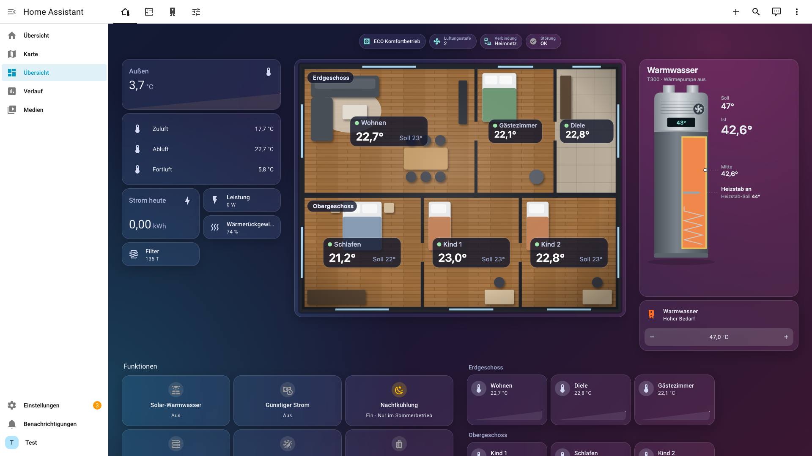
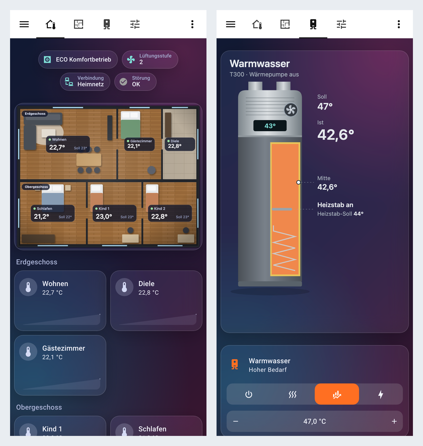
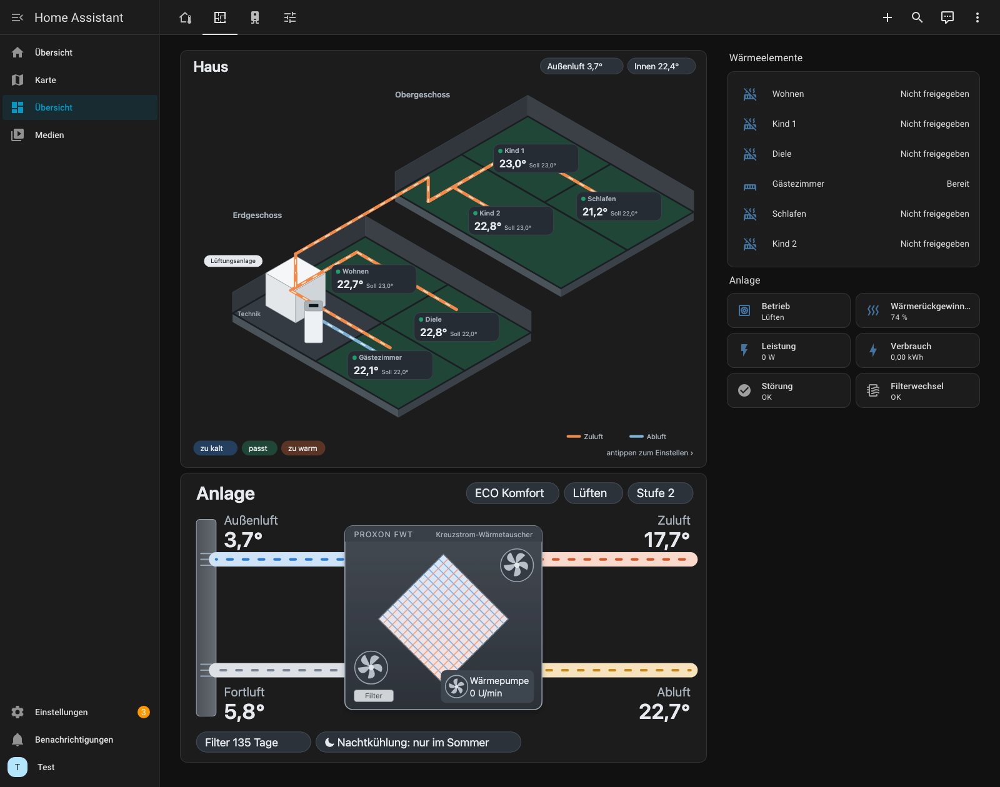
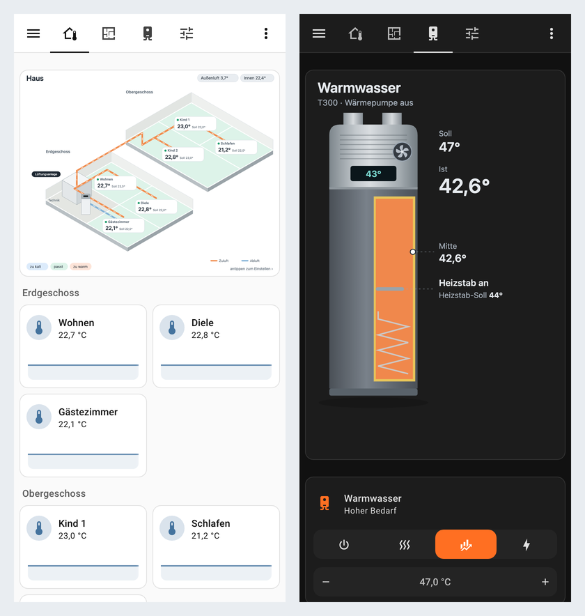

# Changelog / Änderungen

What changed in each version of Proxon Control, newest first. The release notes on GitHub carry the same texts. /
Was sich in jeder Version geändert hat, die neueste zuerst. Die Release-Hinweise auf GitHub enthalten dieselben Texte.

## English summary

**New in 0.24.0:** on the page "Proxon", the hot-water target and the room targets are set with − and + (a swipe while
scrolling no longer changes them); switched-on functions show as small chips in the status row of "Home" (a tap opens
their settings); a refused action (e.g. solar surplus without a sensor) shows in the page's own hint.

**New in 0.23.1:** on the page "Proxon", a long summary in the settings list (e.g. the weekly schedule) no longer widens
its row over the section beside it; it is cut with "…".

**New in 0.23.0:** the settings tab of the page "Proxon" is a list of sections with a short status each and the chosen
section beside it (on a phone: the list, and the section opened over it); the automatic functions are grouped in one
section; on a phone the tabs sit in a bar at the bottom; the humidity and CO₂ limits show the value measured now.

**New in 0.22.2:** switches on the page "Proxon" flip at once and wait for the unit (a second tap no longer switches
holiday mode back); holiday mode is switched on there only with departure and return; after an update the browser always
loads the new page; the version shows at the bottom of the settings tab.

**New in 0.22.1:** on the page "Proxon", the settings sections no longer overlap on wide screens (the weekly schedule
pushed into the column next to it); a day's phases now show below its name.

**New in 0.22.0:** a page "Proxon" of its own in the sidebar, in the liquid-glass look: the unit as a section with the air
flowing, the hot-water tank, every room (drag to set the target), cards for the functions that are running, and a tab with
all settings; legionella protection can be planned on a weekday at a time; solar / cheap-power hot water and legionella
protection with solar can only be switched on with their sensor; the ready-made dashboard is now called "Proxon Control".

**New in 0.21.0:** a holiday plan (departure and return: holiday mode switches itself on and off again a few hours
before you are back); one switch for the heating elements of all rooms; both on the start page of the dashboard.

**New in 0.20.1:** the button "set the unit's clock" is gone again: the unit refuses writing its clock over the network
(`NP_E_NO_ACCESS`); please set it at the control panel or in the Proxon app.

**New in 0.20.0:** a button to set the unit's clock from Home Assistant (removed in 0.20.1); a notice under *Repairs* when the hot water has
gone a week without 60 °C and no legionella protection is on; a time of your choice for the legionella heating when a week
brought no sun (13:00 by default); a "House" tab with the floor plan and the drawn house; rooms in
the basement as a third floor; a fixed electricity price now replaces the price sensor completely; fixes from the diagnostics
of three real units.

**New in 0.19.0:** the dashboard in the "Proxon Bento" look (rounded tiles, light and dark following the device); the
start page with the key figures in one row and every room as a tile (temperature, target -/+, heating element); the theme
comes with "create dashboard".

**New in 0.18.0:** the weekly ventilation schedule can be switched on and off as a whole; the year forecast follows the
season (the compressor weighted by the typical heating of each month); the unit as large as the house on the start page.

**New in 0.17.1:** a fixed electricity price (ct/kWh) as an option for the cost with a fixed tariff; the power right now on the
start page and at the top of the power tab.

**New in 0.17.0:** the ready-made dashboard in five tabs by task (home, hot water, optimisation, power, settings), with the
rooms' targets right on the start page, created by the action itself as the dashboard "Proxon" in the sidebar; electricity cost
per day, week, month and year; a forecast of this month's and year's consumption and cost.

**New in 0.16.0:** energy consumption per day, week, month and year (total, compressor, ventilation and electronics), and
the energy of ventilation and electronics as a counter of its own.

**New in 0.15.2:** the diagnostics download no longer contains the unit's IP address or the house photo; values of an FWT 3.0
(firmware 12) checked.

**New in 0.15.1:** a *read-only* option (show every value, never change anything on the unit; contributed by NicerDicerPro).

**New in 0.15.0:** *shower supply* (for how many minutes of showering the hot water lasts, also on the T300 picture);
*legionella protection with solar power* (the weekly heating to 60 °C on a day with solar surplus, after a week at the latest;
replaces the unit's own legionella function while on); *electricity cost* (with a price sensor in the options); a new dashboard tab
*Energy* (consumption and cost today / this week / month / year, per day and month, power, runtimes and compressor starts per day).

**New in 0.14.1:** the heat recovery sensor keeps its last measurement across a restart of Home Assistant (it can only measure
while the heat pump pauses, so in winter it stayed empty after an update).

**New in 0.14.0:** the "glass" dashboard: on tablets and computers a control panel with a schematic floor plan from above (rooms,
floors and furniture by the room names; temperature, target and a flame per room; tap a room for its thermostat), the T300 and the
functions; the theme "Proxon Glas" (frosted glass on a dark gradient) is installed by the action *Install glass theme*.

**New in 0.13.0:** a new dashboard: the house drawn isometric (ground and upper floor, ducts from the unit, every room coloured by
actual vs target with a flame while its heating element heats), the T300 drawn cut open (water coloured by its two sensors, immersion heater,
charge), a phone start page with your own house photo and the key values on it, room cards with 24-hour curves, a hot-water tab, and
an indoor average sensor. Choose the upper-floor rooms and the photo under *Configure*.

**New in 0.12.0:** heat demand per room as in the Proxon app (thermostat shows heating when the element is released and the room
too cold), "heating elements heating" with active channels, compressor power in %, device type (no cooling switch on heating-only units).

**New in 0.11.0:** automatic summer/winter switching (by the 2-day outdoor average), runtime statistics (lifetime hour counters,
starts and runtime today, short-cycling notice), night setback settings, hot-water module faults by name.

**New in 0.10.0:** power draw (total, compressor, ventilation) and energy counters (kWh) for the Energy dashboard; weekly schedule phases
across midnight are understood.

**New in 0.9.0:** stove mode, legionella protection, boost duration, filter lifetime as set at the unit, hot-water charge, heat recovery,
current operation, PV input, bypass and more diagnostics; every room as its own device (assignable to an area), the weekly schedule as time/level
settings with "copy Monday" buttons, a write guard while the unit reports a fault, a clock deviation notice, and new blueprints (stove, outdoor air,
nobody home).

**Upgrading to 0.3.2:** room thermostats now use the modes `auto` (unit regulates the room) and `heat` (electric heating element released) instead of `off`/`heat`; up to 20 rooms are supported.

**Upgrading from 0.1.x:** rooms are now thermostats (`climate` entities). The old room numbers and switches are removed on start; update automations and dashboards that used them.

## Änderungen im Detail (deutsch)

### Neu in Version 0.24.0

* **Sollwerte mit − und + statt Wischen:** Auf der Seite „Proxon“ war die ganze Warmwasser-Karte ein Schieberegler –
  ein leicht schräges Wischen beim Scrollen auf dem Handy hat die Warmwasser-Solltemperatur verstellt (z. B. auf 52 oder
  55 °C). Jetzt ändern Warmwasser-Karte, ihr Sheet und die Einstellungen den Sollwert nur mit − und + (1 °C je Tipp,
  mehrere Tipps werden einmal gesendet). Die Raum-Kacheln und ihre Sheets genauso, in Schritten des Thermostats. Ein
  Tipp auf die Karte oder Kachel öffnet wie bisher die Details.
* **Eingeschaltete Funktionen in der Statuszeile:** Oben auf „Zuhause“ steht jede eingeschaltete Funktion als kleine
  Kapsel neben Außentemperatur und Betrieb – mit dem Wichtigsten in wenigen Wörtern, z. B. „Urlaub ab So., 16:52“,
  „Legionellenschutz So., 14:00“ oder „Sommer/Winter Winter“. Arbeitet eine Funktion gerade, ist sie farbig hinterlegt
  und hat einen pulsierenden Punkt. Ein Tipp öffnet ihre Einstellung. Bisher erschien eine Funktion nur, während sie
  heizte oder kühlte, und dann als große Karte mit Schalter.
* **Hinweise im Design der Seite:** Wird eine Aktion abgelehnt – z. B. PV-Überschuss ohne gewählten Sensor –, erscheint
  der Hinweis unten auf der Seite wie der Hinweis zur Urlaubsplanung, nicht mehr als Fehlermeldung von Home Assistant.

### Neu in Version 0.23.1

* **Seite „Proxon“, Tab „Einstellungen“:** Eine lange Kurzinfo in der Liste (z. B. das Wochenprogramm mit zwei Phasen)
  machte ihre Zeile breiter als die Liste, so dass sie über den Bereich daneben ragte. Jetzt bleibt die Zeile in der
  Liste, und die Kurzinfo endet mit „…“.

### Neu in Version 0.23.0

* **Seite „Proxon“, Tab „Einstellungen“ neu geordnet:** Wie die Einstellungen auf iPad und Mac stehen links die Bereiche
  (Lüftung, Wochenprogramm, Urlaub, Warmwasser, Automatiken, Nachtabsenkung), jeder mit Symbol und einer Kurzinfo –
  z. B. die Messwerte von jetzt, der geplante Urlaub, die Solltemperatur oder wie viele Automatiken laufen. Rechts steht
  nur der gewählte Bereich. Auf dem Handy erscheint zuerst die Liste, ein Tipp öffnet den Bereich, „‹ Einstellungen“
  (oder ein zweiter Tipp auf den Tab) führt zurück.
* **Automatiken zusammengefasst:** Warmwasser-Boost, PV-Überschuss und günstiger Strom, Legionellenschutz,
  Nachtkühlung und Sommer/Winter stehen in einem Bereich; jede Zeile zeigt Status und Schalter, die Grenzwerte klappen
  erst beim Antippen auf.
* **Tabs unten auf dem Handy:** „Zuhause“ und „Einstellungen“ sitzen auf schmalen Bildschirmen in einer Leiste am
  unteren Rand, wo der Daumen hinkommt. Die Seite hält oben Abstand zur Statusleiste (in der Companion-App lag die
  Kopfzeile bisher darunter).
* **Grenzwert Feuchte und CO₂ mit dem Wert von jetzt:** Unter beiden Grenzwerten steht die aktuelle Messung, und eine
  Markierung auf dem Schieberegler zeigt, wo sie liegt (CO₂ nur, wenn ein Fühler Werte liefert).

### Neu in Version 0.22.2

* **Schalter auf der Seite „Proxon“:** Ein Schalter springt beim Tippen sofort um und zeigt „wird eingeschaltet …“, bis
  die Anlage es bestätigt; weitere Tipps werden solange ignoriert. Bisher zeigte er bis zur Bestätigung den alten Zustand –
  beim Urlaubsmodus, der viele Werte schreibt und an einer echten Anlage eine Weile braucht, schaltete ein zweites Tippen
  ihn wieder zurück.
* **Urlaubsmodus nur mit Abreise und Rückkehr:** Auf der Seite „Proxon“ lässt er sich erst einschalten, wenn Abreise und
  Rückkehr eingetragen sind (Rückkehr in der Zukunft, nach der Abreise); sonst ein Hinweis, und das fehlende Feld ist
  gleich ausgewählt. Automationen und die Urlaubs-Vorlagen schalten weiter wie bisher.
* **Nach einem Update lädt der Browser sicher die neue Seite** (bisher konnte er die alte behalten, so dass z. B. die
  Korrektur aus 0.22.1 nicht ankam). Unten im Tab „Einstellungen“ steht jetzt die installierte Version.

### Neu in Version 0.22.1

* **Seite „Proxon“, Tab „Einstellungen“:** Auf breiten Bildschirmen überlappten sich die Abschnitte – lange
  Tageszusammenfassungen im Wochenprogramm schoben die Karte unter die Spalte daneben („Urlaub“). Jetzt bleibt jeder
  Abschnitt in seiner Spalte, und die Phasen eines Tages stehen vollständig unter dem Wochentag.

### Neu in Version 0.22.0: eigene Seite „Proxon“, Legionellenschutz planen

* **Neue Seite „Proxon“ in der Seitenleiste** – eine eigene Oberfläche im „Liquid Glass“-Look (durchscheinende Flächen,
  hell und dunkel wie Home Assistant), die nach dem Update ohne weiteres Zutun erscheint:
  * **Zuhause:** oben Außentemperatur, Betrieb und „Alles in Ordnung“ (oder Störung / Filter); darunter eine Karte für
    jede Funktion, die *gerade läuft* (Urlaubsmodus, PV-Überschuss, günstiger Strom, Warmwasser-Boost,
    Legionellenschutz, Nachtkühlung) – ihr Schalter beendet sie, mit „Rückgängig“.
  * **Lüftungsanlage im Schnitt:** vier Luftkanäle, eingefärbt nach ihren Temperaturen, die Luft strömt je nach Stufe,
    die Lüfter drehen nach ihrer Drehzahl, die Wärmepumpe zeigt, ob sie heizt, kühlt oder aus ist; Kompressor,
    Wärmerückgewinnung, CO₂ und Feuchte darunter. Direkter Schalter für die **Intensivlüftung** mit Restzeit. Antippen:
    Stufe (rastet ein; im ECO-Komfortbetrieb ausgegraut, da regelt die Anlage selbst), Betriebsart, „Alle Werte“.
  * **Warmwasser als großer Speicher:** 300 Liter mit Wasserstand und Schichten, die Fühler an ihrer Stelle, daneben
    Liter warmes Wasser, Duschvorrat und Temperatur; das Soll lässt sich direkt auf der Karte ziehen.
  * **Räume nach Geschossen:** Temperatur, Soll (zur Seite ziehen, rastet ein), Heizpanel; darüber der Schalter
    „Wärmeelemente aller Räume“ (Rückgängig stellt jeden Raum wieder so ein, wie er war).
  * **„Alle Werte“** bei Lüftung und Warmwasser: jede Entität dieses Teils, gruppiert und live, antippen zeigt den
    Verlauf; dazu „Gerät in Home Assistant öffnen“.
  * **Tab „Einstellungen“:** Lüftung (Grenzwerte mit Erklärung), Wochenprogramm (pro Tag drei Phasen, Montag kopieren),
    Urlaub, Warmwasser, Warmwasser-Boost, PV-Überschuss und günstiger Strom, Legionellenschutz, Nachtkühlung,
    Sommer/Winter automatisch, Nachtabsenkung – jeweils mit dem, was die Funktion gerade tut.
  * Bewegung wie bei Apple: Federn, Ziehen mit Schwung, nichts davon mit „Bewegung reduzieren“.
* **Das fertige Dashboard heißt jetzt „Proxon Control“** (ein bestehendes „Proxon“ wird beim Start umbenannt, ein selbst
  gewählter Titel bleibt), damit „Proxon“ nicht zweimal in der Seitenleiste steht.
* **Legionellenschutz planen:** neuer Schalter mit Wochentag und Uhrzeit – heizt jede Woche dann auf 60 °C, mit oder
  ohne Sonne (ausgelassen, wenn das Wasser am Tag davor schon so heiß war). Nur eine der beiden Varianten ist an.
* **Ohne Sensor kein stilles Nichtstun mehr:** „Warmwasser mit PV-Überschuss“ und „Legionellenschutz mit Sonne“ lassen
  sich ohne Überschuss-Sensor nicht einschalten, „Warmwasser mit günstigem Strom“ nicht ohne Strompreis-Sensor oder mit
  festem Preis – eine Meldung sagt, wo der Sensor gewählt wird.

### Neu in Version 0.21.0: Urlaubsplan, Wärmeelemente aller Räume

* **Urlaubsplan:** Am Gerät Proxon gibt es **„Urlaubsplan: Abreise“** und **„Urlaubsplan: Rückkehr“** (Datum und
  Uhrzeit). Zur Abreise geht der Urlaubsmodus selbst an, vor der Rückkehr wieder aus – so viele Stunden vorher, wie unter
  **„Urlaubsplan: vor der Rückkehr aufwärmen“** eingestellt (voreingestellt 6), damit Haus und Wasser warm sind. Danach ist
  der Plan gelöscht. Wer früher zurückkommt und den Urlaubsmodus selbst ausschaltet, beendet den Plan damit ebenfalls.
  Der Knopf **„Urlaubsplan löschen“** nimmt einen Plan zurück, bevor er beginnt. Am Schalter „Urlaubsmodus“ zeigen die
  Attribute `plan_on_at` und `plan_off_at`, wann er schaltet. Geprüft wird einmal pro Minute.
* **Wärmeelemente aller Räume:** ein Schalter, der die Wärmeelemente aller Räume auf einmal freigibt oder sperrt (z. B.
  im Frühjahr). Er ist an, wenn alle freigegeben sind; die Attribute zeigen, welche Räume an und aus sind. Geschrieben
  werden nur die Räume, die anders stehen – wie beim Umschalten im Thermostat des Raums. (Idee aus ha-lan-proxon 2.8.1.)
* **Dashboard:** Auf „Zuhause“ stehen Abreise und Rückkehr direkt beim Urlaubsmodus und der Schalter für alle
  Wärmeelemente über den Räumen; unter *Einstellungen* der ganze Urlaubsplan. Zum Übernehmen „Dashboard erstellen“
  ausführen.

### Neu in Version 0.20.1

* **Knopf „Uhr der Anlage stellen“ entfernt:** Die Anlage lässt das Stellen ihrer Uhr über das Netz nicht zu (sie antwortet
  mit `NP_E_NO_ACCESS`). Der Knopf verschwindet beim Start von selbst. Die Uhr bitte am Bedienpanel oder in der Proxon-App
  stellen; der Hinweis unter *Reparaturen* sagt wieder genau das.

### Neu in Version 0.20.0: Uhr stellen, Legionellen-Hinweis, Haus-Tab, Keller

* **Uhr der Anlage stellen:** Der Knopf **„Uhr der Anlage stellen“** (unter *Konfiguration* des Geräts) überträgt Datum und
  Uhrzeit von Home Assistant auf die Anlage. Geschrieben wird nur, was abweicht; kurz vor einem Minutenwechsel wartet er die
  neue Minute ab. Wichtig, weil Wochenprogramm und Nachtabsenkung nach der Uhr der Anlage laufen. Der Hinweis „Die Uhr der
  Anlage geht falsch“ unter *Reparaturen* verweist jetzt auf den Knopf.
* **Hinweis zum Legionellenschutz:** War das Warmwasser 7 Tage lang nicht mindestens 60 °C heiß und ist weder die
  Legionellenschaltung der Anlage noch „Legionellenschutz mit Sonne“ eingeschaltet, erscheint ein Hinweis unter
  *Einstellungen → Reparaturen*. Er verschwindet von selbst, sobald eine der beiden eingeschaltet ist oder das Wasser heiß
  genug war. Besonders wichtig mit einer Zirkulationspumpe. Die 7 Tage zählen ab dem Update.
* **Legionellenschutz mit Sonne – Uhrzeit ohne Sonne:** Kam eine Woche lang keine Sonne, heizt er jetzt nicht mehr zu
  der Minute, in der die Woche um ist (das konnte mitten in der Nacht sein), sondern an diesem Tag zu einer wählbaren
  Uhrzeit: **„Legionellenschutz: ohne Sonne um“**, voreingestellt 13:00 (mittags reicht oft noch etwas Sonne; nachts
  passt für einen günstigen Nachttarif). Im Dashboard unter *Optimierung → Legionellenschutz mit Sonne*.
* **Neuer Tab „Haus“** im Dashboard: oben der Grundriss (alle Geschosse), darunter das gezeichnete Haus; jeder Raum
  gefärbt nach Ist gegenüber Soll, antippen öffnet seinen Thermostat. Zum Übernehmen „Dashboard erstellen“ ausführen.
* **Keller:** Unter *Proxon Control → Konfigurieren* gibt es **„Räume im Keller“**. Räume mit Namen wie Keller,
  Hobbyraum oder Werkstatt werden dort vorausgewählt. Kellerräume stehen auf der Startseite unter eigener Überschrift und im
  Grundriss als drittes Geschoss (im gezeichneten Haus nicht).
* **Fester Strompreis hat Vorrang:** Ist ein fester Preis eingetragen, gilt er für alle Kosten; ein Strompreis-Sensor wird
  dann ganz ignoriert (auch für „Warmwasser mit günstigem Strom“, ein fester Tarif hat keine günstigen Stunden).
* **Korrekturen aus den Diagnosedateien dreier Anlagen** (danke an alle, die eine geschickt haben):
  * „Wärmebedarf“ der Räume (zu kalt / passt / wärmer) kommt jetzt nur aus Ist gegenüber Soll. Der „LED“-Wert der
    Raumbedienteile ist das am Bedienteil eingestellte Soll, kein Wärmebedarf.
  * **„Betriebsstunden Warmwasser-Kompressor“** (auf allen Anlagen etwa doppelt so viele Stunden wie die ganze Anlage) und
    **„T14 Sauggas“** sind standardmäßig ausgeblendet und tragen „(ungeprüft)“ im Namen. Sie lassen sich unter den
    Entitäten wieder einblenden.

### Neu in Version 0.19.0: Dashboard im Bento-Look

* **Theme „Proxon Bento“** mit hellem und dunklem Modus: helle, stark gerundete Kacheln mit grünem Akzent, nachts
  Graphit. Es folgt automatisch dem Hell/Dunkel des Geräts; im Profil lässt es sich fest wählen (z. B. für ein
  Wandtablet). „Proxon Glas“ bleibt zur Auswahl im Profil. „Dashboard erstellen“ installiert die Themes selbst; die Bilder
  folgen jetzt ebenfalls dem Gerät (die frühere feste Einstellung „dunkel“ wird dabei zurückgesetzt).
* **Startseite „Zuhause“ neu:**
  * oben die wichtigsten Werte in einer Reihe: Außen, Innen und Warmwasser mit dem Verlauf des letzten Tages, die
    Leistung jetzt (auf dem Handy zu zweit),
  * die Lüftung (Stufe, Betriebsart, Intensivlüftung, Urlaubsmodus, Zeitprogramm) und die Automatiken mit ihrem Status,
  * **jeder Raum als eigene Kachel:** die Temperatur groß, das Soll mit − / +, das Heizelement; antippen öffnet den
    Thermostat,
  * die Anlage, Warmwasser kurz und die Luft.

  Grundriss und gezeichnetes Haus stehen nicht mehr auf der Startseite (die Bilder gibt es weiter als Entitäten).
* Die Aktion „Glas-Theme installieren“ heißt jetzt „Dashboard-Theme installieren“ (der Name für Automationen bleibt
  `install_glass_theme`).

Zum Übernehmen nach dem Update „Dashboard erstellen“ ausführen.

### Neu in Version 0.18.0

* **Zeitprogramm global an/aus:** Der Schalter **„Zeitprogramm Lüftung“** schaltet das ganze Wochenprogramm der Lüftung ein
  oder aus (wie „Zeitprogramm An/Aus“ am Bedienteil); die eingestellten Phasen bleiben dabei erhalten. Er ersetzt die
  bisherige reine Anzeige „Zeitprogramm aktiv“, die beim Start entfernt wird. Im Dashboard unter *Einstellungen →
  Wochenprogramm Lüftung*. (Geschrieben wie die übrigen Werte des Zeitprogramms; bitte einmal am Bedienteil oder in der App
  prüfen, ob das Umschalten ankommt.)
* **Jahres-Hochrechnung nach Jahreszeit:** Lüftung und Elektronik werden gleichmäßig hochgerechnet, der Kompressor nach dem
  typischen Heizbedarf jedes Monats (Heizgradtage eines durchschnittlichen deutschen Jahres) gewichtet. Ein paar gezählte
  Wintertage ergeben so kein ganzes Jahr Winter mehr. Die Kosten fürs Jahr: diese Energie zum bisherigen Durchschnittspreis.
  Die Hochrechnung für den Monat bleibt linear.
* **Dashboard:** Auf „Zuhause“ steht das Bild der Anlage so groß wie das Haus darunter. Zum Übernehmen „Dashboard
  erstellen“ noch einmal ausführen.

### Neu in Version 0.17.1

* **Fester Strompreis:** Unter *Geräte & Dienste → Proxon Control → Konfigurieren* lässt sich ein fester Preis in ct/kWh
  eintragen (z. B. 32,5). Damit gibt es die Stromkosten (gesamt, heute, Woche, Monat, Jahr, Hochrechnung) auch ohne
  dynamischen Tarif. Ist zusätzlich ein Strompreis-Sensor gewählt, zählt der Sensor. Die Kosten zählen ab dem Eintragen.
* **Leistung jetzt im Dashboard:** im Strom-Tab ganz oben (gesamt mit der letzten Stunde, Kompressor, Lüftung und
  Elektronik) und auf „Zuhause“ bei den Temperaturen. Zum Übernehmen „Dashboard erstellen“ noch einmal ausführen.

### Neu in Version 0.17.0: Dashboard nach Aufgaben, Kosten und Hochrechnung

* **Das fertige Dashboard in fünf Tabs**, je einer für eine Aufgabe:
  1. **Zuhause:** Lüftung bedienen (Stufe, Betriebsart, Intensivlüftung, Urlaubsmodus), Warmwasser kurz, jeder Raum mit
     Soll +/− und der Kurve der letzten 24 Stunden, Grundriss und gezeichnetes Haus, die wichtigsten Temperaturen und die
     Anlage. Auf dem Handy zuerst das Hausfoto (oder der Grundriss).
  2. **Warmwasser:** der T300 im Schnitt, alles zum Einstellen, was die Automatiken gerade tun.
  3. **Optimierung:** jede Automatik (Solar/günstiger Strom, Boost, Legionellenschutz mit Sonne, Nachtkühlung,
     Sommer/Winter, Nachtabsenkung) mit Schalter, Status und Grenzwerten.
  4. **Strom:** Verbrauch und Kosten nach Zeitraum, Aufteilung Kompressor / Lüftung und Elektronik, Hochrechnung, Balken
     pro Tag und Monat, Laufzeiten.
  5. **Einstellungen:** Lüftungs-Grenzwerte, Wochenprogramm, Wärmeelemente, Werte der Anlage, Diagnose.

  Der bisherige Tab „Haus“ entfällt (das gezeichnete Haus steht jetzt auf „Zuhause“).
* **„Dashboard erstellen“ legt das Dashboard selbst an:** Die Aktion legt das Dashboard **„Proxon“** in der Seitenleiste an
  (`/proxon-dashboard`) und schreibt es bei jedem weiteren Aufruf neu – Kopieren und Einfügen entfällt. Achtung: Was darin von
  Hand geändert wurde, wird dabei ersetzt. Wer lieber selbst einfügt, wählt die Option „Nur zum Einfügen“ (wie bisher).
  Dein bisheriges, selbst eingefügtes Dashboard bleibt unverändert; es kann gelöscht werden, wenn „Proxon“ passt.
* **Stromkosten heute, diese Woche, diesen Monat und dieses Jahr** (mit Strompreis-Sensor in den Optionen).
* **Hochrechnung** für diesen Monat und dieses Jahr, für Verbrauch und Kosten: Was bisher gezählt wurde, im gleichen Tempo
  auf den ganzen Zeitraum hochgerechnet. Sie erscheint nach 12 Stunden (Monat) bzw. 3 Tagen (Jahr) Zählzeit; ist erst
  mitten im Zeitraum mitgezählt worden, wird ab da gerechnet. Eine Schätzung: Das Wetter des restlichen Zeitraums
  entscheidet.

### Neu in Version 0.16.0: Energieverbrauch nach Zeitraum

* **Verbrauch heute, diese Woche, diesen Monat und dieses Jahr** als eigene Sensoren, jeweils für
  * den **gesamten** Verbrauch der Anlage,
  * den **Kompressor** (die Wärmepumpe der Lüftungsanlage: Heizen und Kühlen der Zuluft),
  * **Lüftung und Elektronik** (neu auch als fortlaufender Zähler „… gesamt“).

  Gesamt ist Kompressor plus Lüftung und Elektronik. Der Warmwasserspeicher T300 meldet keine Leistung und ist nicht
  enthalten. Die Zeiträume richten sich nach der Ortszeit (die Woche beginnt am Montag) und fangen jeweils wieder bei 0 an;
  nach einem Neustart zählen sie weiter. Direkt nach dem Update beginnen sie bei 0, die Kacheln im Energie-Tab zeigen
  weiterhin die Werte aus der Statistik von Home Assistant.
* Die fortlaufenden Zähler heißen jetzt „Energieverbrauch gesamt“ und „Energieverbrauch Kompressor gesamt“ (nur der
  angezeigte Name; Entity-IDs, Automationen und Dashboards bleiben gleich).
* Energie-Tab: Die Balken pro Tag zeigen zusätzlich Lüftung und Elektronik (Dashboard neu erstellen).

### Neu in Version 0.15.2

* **Diagnose ohne IP-Adresse:** Die IP-Adresse der Anlage (und das Hausfoto) werden aus dem Diagnose-Download entfernt.
  Bisher blieb die eingetragene Heimnetz-Adresse darin stehen. Wer schon eine Diagnosedatei öffentlich geteilt hat:
  Es ist nur die interne Adresse im Heimnetz, von außen nicht erreichbar.
* **FWT 3.0 (Firmware 12):** Mit der Diagnose einer FWT 3.0 geprüft: Werte, Räume und Verbindung im Heimnetz passen. Die
  Raumpanels melden dort im LED-Feld einen anderen Wert als die FWT 2.0; ob ein Raum zu kalt ist, wird dann wie beim
  Wohnzimmer aus Temperatur und Soll bestimmt.

### Neu in Version 0.15.1: Nur lesen

* **Option „Nur lesen“** (beigetragen von NicerDicerPro): Alle Werte werden wie gewohnt gelesen, aber Home Assistant ändert nichts an der
  Anlage. Jede Änderung wird mit einer Meldung abgelehnt, die automatischen Funktionen bleiben untätig. Einzuschalten unter *Geräte &
  Dienste → Proxon Control → Konfigurieren*. Mehr unter „Nur lesen“ weiter unten.
* Hinweis für Home Assistant in Docker Desktop: dort die IP-Adresse der Anlage eintragen (siehe Fehlersuche).

### Neu in Version 0.15.0: Duschvorrat, Legionellenschutz mit Sonne, Energie-Tab

* **Duschvorrat** (Sensor, auch im T300-Bild): Für wie viele Minuten Duschen das Warmwasser noch reicht (40 °C an der
  Brause, 8 Liter pro Minute), in 5-Minuten-Schritten. Gerechnet aus den Fühlern Mitte und unten: die obere Hälfte des
  Speichers mit der Temperatur in der Mitte, die untere mit der unten; nur Wasser über 40 °C zählt. Eine Schätzung, denn der
  Speicher hat oben keinen Fühler.
* **Legionellenschutz mit Sonne** (Schalter, Status-Sensor): Einmal pro Woche muss das Warmwasser auf 60 °C. Statt der
  eigenen Legionellenschaltung der Anlage (feste Uhrzeit, oft mit Netzstrom) heizt der Heizstab an einem Tag mit
  Solarüberschuss:
  * Ab dem 5. Tag nach dem letzten Mal wird auf Sonne gewartet. Der Überschuss muss 10 Minuten über der Schwelle von
    „Solar-Warmwasser“ liegen.
  * Nach 7 Tagen heizt er trotzdem.
  * Dafür wird der Heizstab-Sollwert auf 60 °C gesetzt und der Heizstab eingeschaltet. Fertig ist er, wenn die Mitte 60 °C
    erreicht, spätestens nach 4 Stunden (dann neuer Versuch nach 12 Stunden). Danach werden Sollwert und Heizstab wieder
    wie vorher eingestellt.
  * Wird das Wasser von allein so heiß, zählt das auch.
  * Pause im Urlaubsmodus.
  * Solange der Schalter an ist, ist die Legionellenschaltung der Anlage aus; beim Ausschalten wird sie wieder eingeschaltet,
    wenn sie vorher an war.
* **Stromkosten** (Sensor, nur wenn in den Optionen ein Strompreis-Sensor gewählt ist): Was die Anlage gekostet hat,
  aufsummiert aus Leistung × Preis im jeweiligen Moment.
* **Neuer Dashboard-Tab „Energie“** im Glas-Design:
  * Verbrauch und Kosten heute, diese Woche, diesen Monat und dieses Jahr,
  * Balken pro Tag (30 Tage) und pro Monat,
  * die Leistung der letzten 24 Stunden,
  * Laufzeiten und Kompressor-Starts pro Tag.

  Die Balken füllen sich mit der Zeit: Home Assistant legt die Tageswerte stündlich an. Zum Übernehmen das Dashboard neu
  erstellen (Aktion „Dashboard erstellen“ und den Inhalt im Raw-Konfigurationseditor ersetzen).

### Neu in Version 0.14.1

* **Wärmerückgewinnung bleibt nach einem Neustart erhalten.** Der Sensor kann nur messen, wenn der Kompressor steht (sonst
  wärmt die Wärmepumpe die Zuluft mit). Im Winter läuft er fast durchgehend, deshalb blieb der Sensor nach einem Neustart von
  Home Assistant (z. B. nach einem Update) lange leer. Jetzt wird der letzte Messwert samt Zeitpunkt übernommen. Ob gerade
  gemessen werden kann, zeigt das Attribut `measuring_now`.

### Neu in Version 0.14.0: Glas-Dashboard mit Grundriss

* **Startseite auf Tablet und Computer** (ab 1024 px Breite) als Bedientafel:
  * links Außentemperatur mit Verlauf, Zu-, Ab- und Fortluft, Strom heute, Leistung, Wärmerückgewinnung und Filter,
  * in der Mitte der **Grundriss von oben**,
  * rechts der T300 mit Solltemperatur,
  * darunter die Funktionen als große Kacheln und die Räume mit ihren Kurven.

  Ist weniger Platz, ordnen sich die Abschnitte selbst um (drei oder zwei Spalten).
* **Der Grundriss ist schematisch gezeichnet**, nicht dein echter Grundriss: Größe, Boden (Holz, Fliesen, Stein) und Möbel jedes Raums
  ergeben sich aus seinem Namen (Wohnzimmer mit Sofa und Esstisch, Schlafzimmer mit Bett, Bad mit Wanne …), dazu Wände mit Türen und
  Fenstern, Erd- und Obergeschoss untereinander. Auf jedem Raum stehen Ist, Soll und die Flamme, solange sein Wärmeelement heizt; zu
  kalte Räume sind blau, zu warme orange umrandet. **Jeder Raum lässt sich antippen** und öffnet sein Thermostat.
* **Auf dem Handy** bleibt die Startseite aus 0.13.0: dein Hausfoto (ohne Foto jetzt der Grundriss), die Raumkarten, die Funktionen.
* **Glas-Look für das ganze Dashboard:** neues Theme „Proxon Glas“ (Milchglas-Karten auf dunklem Farbverlauf). Installiert wird es mit
  der Aktion **„Proxon Control: Glas-Theme installieren“** (*Entwicklerwerkzeuge → Aktionen*). Sie legt das Theme im Ordner `themes`
  ab, lädt die Themes neu und stellt die Dashboard-Bilder auf dunkel. Alle Reiter des fertigen Dashboards nutzen das Theme.
  * Kopfzeile und Seitenleiste bleiben im normalen Theme. Auf einem Wandtablet wählst du „Proxon Glas“ im Profil, dann ist alles im
    Glas-Look.
  * Lädt Home Assistant den Ordner `themes` nicht, sagt die Antwort der Aktion, welche Zeile in `configuration.yaml` fehlt
    (`themes: !include_dir_merge_named themes` unter `frontend:`; in der Standard-Konfiguration ist sie schon da).
* Oben auf der Startseite: Betriebsart, Lüftungsstufe, Verbindung und Störung als Plaketten. Neues Bild-Entity „Bild Grundriss“.

**Nach dem Update:**
1. Home Assistant **neu starten** (erst dann ist der neue Code aktiv).
2. Einmal die Aktion **„Proxon Control: Glas-Theme installieren“** ausführen.
3. Das Dashboard neu erzeugen: „Proxon Control: Dashboard erstellen“ → Antwort kopieren → im Dashboard ✏️ → ⋮ →
   *Raw-Konfigurationseditor* → Inhalt ersetzen.

### Neu in Version 0.13.0: Neues Dashboard mit Haus im Schnitt und T300

* **Haus isometrisch:** Erdgeschoss vorne, Obergeschoss dahinter, jeder Raum mit Ist- und Solltemperatur, gefärbt nach Ist gegenüber Soll
  (blau zu kalt, grün passt, orange zu warm) und mit flackernder Flamme, solange sein Wärmeelement heizt. Im Technikraum stehen die
  Lüftungsanlage und der T300; von dort laufen die Zuluftleitungen in jeden Raum (auch hinauf ins Obergeschoss) und die Abluft zurück –
  die Luft strömt, solange die Lüftung läuft. Bei vielen Räumen wählt die Integration selbst Raster und Beschriftungsgröße, damit sich
  nichts überdeckt. **Jeder Raum lässt sich antippen** und öffnet sein Thermostat.
* **T300 im Schnitt:** der Speicher aufgeschnitten, das Wasser gefärbt nach den beiden Fühlern (Mitte, unten), Wärmetauscher-Wendel,
  Heizstab (glüht, solange sein Relais an ist), Lüfter der Wärmepumpe (dreht sich, solange der Verdichter läuft), daneben Soll, Ist,
  Ladezustand und Heizstab.
* **Startseite fürs Handy:** oben **dein eigenes Hausfoto** mit Außen-, Innen- und Warmwassertemperatur und dem aktuellen Betrieb
  darauf (ohne Foto das gezeichnete Haus), darunter jeder Raum als Karte mit seiner Temperaturkurve der letzten 24 Stunden – nach Etagen
  getrennt, antippen öffnet das Thermostat –, daneben Lüftung, Betriebsart, Warmwasser und die Funktionen.
* **Vier Reiter:** *Zuhause*, *Haus* (Haus und Anlage groß, Wärmeelemente je Raum, Werte der Anlage), *Warmwasser* (T300, Betriebsart
  und Solltemperatur, Verlauf der letzten 24 Stunden, Schalter) und *Einstellungen* wie bisher.
* **Neuer Sensor „Innen (Mittel)“:** die mittlere Temperatur aller Räume mit Bedienteil.
* **Neue Einstellungen** unter *Proxon Control → Konfigurieren*: **Räume im Obergeschoss** (vorausgewählt nach den Namen wie Schlaf- oder
  Kinderzimmer – nichts auswählen bei einem Bungalow) und **Hausfoto** (z. B. `/config/www/proxon/haus.jpg` ablegen und
  `/local/proxon/haus.jpg` eintragen).

**Dashboard aktualisieren:** *Entwicklerwerkzeuge → Aktionen* → „Proxon Control: Dashboard erstellen“ → Antwort kopieren → im Dashboard
✏️ → ⋮ → *Raw-Konfigurationseditor* → Inhalt ersetzen. Der Verlauf in den Raumkarten und auf der Warmwasser-Seite braucht die
Verlauf-Integration (ist bei normalen Installationen dabei).

### Neu in Version 0.12.3

* **„Heizt“ wie die Anlage es entscheidet:** Die Anlage schaltet ein freigegebenes Wärmeelement zu, wenn der Raum um ihre
  *Einschaltschwelle* unter dem Sollwert liegt, und erst wieder ab, wenn er bis auf die *Ausschaltschwelle* aufgeholt hat. Beide Schwellen
  werden jetzt gelesen (Diagnose-Sensoren „Wärmeelemente Einschaltschwelle / Ausschaltschwelle“, Proxons Modbus-Liste 4x0317/4x0318), und der
  Sensor „Wärmeelement“ rechnet damit (Attribute `below_target` und `decided_by`). Liefert die Anlage keine plausiblen Schwellen, zählt wie
  bisher die Anzeige des Raum-Bedienteils.

### Neu in Version 0.12.2

* **Wärmeelement je Raum mit drei Zuständen:** neuer Sensor „Wärmeelement“ im Gerät jedes Raums – *Nicht freigegeben*, *Bereit*
  (freigegeben, der Raum braucht keine Wärme) oder *Heizt* (freigegeben und der Raum zu kalt, wie die Proxon-App es zeigt). Welches Relais
  wirklich schaltet, meldet die Anlage nur je Kanal, nicht je Raum.
* Die Thermostat-Modi heißen jetzt **„Wärmeelement aus“** und **„Wärmeelement freigegeben“** (vorher „Automatik (Wärmepumpe)“ und
  „Mit Wärmeelement“) – die Wärmepumpe regelt in beiden Fällen weiter.

### Neu in Version 0.12.1 (Verbesserungen aus einer Code-Prüfung)

* Die **Filter-Erinnerung des Warmwasser-Moduls** gilt nicht mehr als Störung: Sie steht weiter im Sensor „Störung“ (Attribut
  `hot_water_module`), sperrt aber keine Änderungen mehr und erzeugt keinen Störungs-Hinweis.
* **Wochenprogramm kopieren** übernimmt jetzt auch Phasen über Mitternacht (z. B. 21:01–06:00), die die Anlage schon gespeichert hat.
* **Sommer/Winter-Automatik:** Eine von Hand gewählte Betriebsart (Bedienpanel, App oder Home Assistant) bleibt 12 Stunden bestehen,
  statt gleich zurückgestellt zu werden.
* **„Heimnetz zuerst“:** Fällt nach einem kurzen Aussetzer im Heimnetz auch der Proxon-Server aus, wird das Heimnetz trotzdem versucht –
  die Anlage bleibt erreichbar.
* Der Schlüssel des Heimnetz-Zertifikats wird von Anfang an nur für den eigenen Benutzer lesbar angelegt.
* Die Raumnamen werden nur noch etwa alle 5 Minuten gelesen (bei neuen Räumen sofort) – weniger Anfragen an die Anlage.
* Für Entwickler: Codeprüfung mit Ruff, mypy und Bandit läuft bei jeder Änderung mit; Testwerkzeuge sind festgelegt und werden über Dependabot aktuell gehalten.

### Neu in Version 0.12.0

* **Wärmebedarf je Raum wie in der Proxon-App:** Jedes Raum-Bedienteil meldet, ob der Raum zu kalt, am Sollwert oder wärmer ist
  (Attribut `heat_demand` am Thermostat). Ist das Wärmeelement freigegeben und der Raum zu kalt, zeigt das Thermostat „Heizt“ und das
  Hausbild die Flamme – wie die App. (Beim zentralen Bedienteil wird dafür Ist- mit Soll-Temperatur verglichen.)
* **„Wärmeelemente heizen“:** ob die elektrischen Wärmeelemente gerade wirklich heizen, mit den eingeschalteten Kanälen K1–K10 als Attribut
  (welcher Kanal zu welchem Raum gehört, steht im Verkabelungsplan der Anlage).
* **Kompressor-Leistung** in % und **Gerätetyp** (nur Heizen / Heizen und Kühlen); bei Anlagen ohne Kühlung entfällt der Kühlschalter.
* Idee und Bedeutung der Werte nach dem Projekt [ha-modbus-proxon](https://github.com/charly166/ha-modbus-proxon) (kein Code übernommen).

### Neu in Version 0.11.0

* **Automatische Sommer/Winter-Umschaltung** (Schalter, standardmäßig aus): Die Integration wechselt die Betriebsart nach der mittleren
  Außentemperatur der letzten zwei Tage – unter „Winter unter“ (Standard 14 °C) auf Winter, über „Sommer über“ (Standard 17 °C) auf Sommer,
  dazwischen bleibt alles, höchstens alle 12 Stunden ein Wechsel. Nur wenn die Anlage in Sommer oder Winter läuft; ECO Komfort, Aus,
  Ofenbetrieb und Urlaub bleiben unberührt. Die Außentemperaturen werden schon gesammelt, solange der Schalter aus ist.
* **Laufzeit-Statistik:** Betriebsstunden der Anlage einzeln (Kompressor Heizen / Kühlen, Abtauen, Vorwärmung, jede Lüftungsstufe;
  Warmwasser-Kompressor und Heizstab) und für heute Starts und Laufzeit von Kompressor, Warmwasser-Kompressor und Heizstab (gestern als
  Attribut). Startet der Kompressor an einem Tag 30-mal oder öfter, erscheint ein Hinweis unter *Reparaturen* (Takten).
* **Nachtabsenkung** der Anlage: an/aus, Beginn, Ende und Nachttemperatur ablesen und einstellen (eigenes Zeitprogramm der Anlage).
* **Störungen des Warmwasser-Moduls im Klartext** (z. B. „Filter wechseln“, „Niederdruck“, „Fühler T20 (Speicher unten)“) – im Sensor
  „Störung“ (Attribut `hot_water_module`) und im Hinweis unter *Reparaturen*. Für die Hauptanlage nennt Proxons Liste keine Texte.
* Adressen aus Proxons Modbus-Liste (FWT 2.0). Die Nachtabsenkung schreibt nach demselben Schema wie das Wochenprogramm; jede Änderung
  wird von der Anlage zurückgelesen und sonst als Fehler gemeldet.

### Neu in Version 0.10.0

* **Stromverbrauch der Anlage:** Leistungsaufnahme gesamt, des Kompressors und von Lüftung und Elektronik (W), direkt von der Anlage gemessen,
  und daraus **Energieverbrauch** gesamt und Kompressor (kWh). Die kWh-Sensoren lassen sich im **Energie-Dashboard** unter
  *Einzelne Geräte* eintragen. Das Warmwasser-Modul ist darin nicht enthalten. (Adressen aus Proxons Modbus-Liste, an einer echten Anlage geprüft.)
* **Wochenprogramm: Phasen über Mitternacht** (z. B. 21:01–06:00, an der Anlage eingestellt) werden jetzt richtig verstanden. Bisher ließ sich
  an solchen Tagen keine Phase ändern. Neue Phasen über Mitternacht legt die Integration weiterhin nicht selbst an.
* Die Arbeitszahl (COP) aus der Modbus-Liste meldet die Anlage über das Netz nicht (bleibt 0); sie wird daher nicht angeboten.

### Neu in Version 0.9.1

* **„Aktueller Betrieb“ korrigiert:** Die in 0.9.0 gelesene Adresse blieb an einer echten Anlage auf „Lüften“, obwohl der Kompressor lief.
  Der Wert ergibt sich jetzt aus Kompressor und 4-Wege-Ventil und stimmt damit immer.
* **Prüfwerte in der Diagnose-Datei:** Einige Werte aus Proxons Modbus-Liste (Leistungsaufnahme, Luftmenge, Arbeitszahl, Störungs-Sammelmeldung)
  werden zusätzlich gelesen und nur in die Diagnose-Datei geschrieben (`Pruefwert_DP0_…`). Damit lässt sich an einer echten Anlage klären, welche
  Adresse was enthält, bevor daraus Sensoren werden.

### Neu in Version 0.9.0

**Neue Einstellungen und Werte** (Adressen wie im Projekt [ha-lan-proxon](https://github.com/Fummy1990/ha-lan-proxon) dokumentiert):

* **Ofenbetrieb** als Betriebsart: Bei Kamin oder Kaminofen hält die Anlage einen leichten Überdruck, damit kein Rauch in den Raum gezogen wird.
* **Legionellenschaltung** des Warmwasser-Moduls als Schalter, **Dauer der Intensivlüftung** einstellbar.
* **Filter-Restlaufzeit nach der Standzeit, die an der Anlage eingestellt ist** (3–8 Monate). Bisher wurde fest mit 6 Monaten gerechnet –
  wer eine kürzere Standzeit eingestellt hat, bekam den Hinweis „Filterwechsel bald nötig“ zu spät.
* **Warmwasser unten** (zweiter Fühler im Speicher) und daraus der **Warmwasser-Ladezustand** in % (geschätzt).
* **Aktueller Betrieb** (Lüften / Heizen / Kühlen), aus Kompressor und 4-Wege-Ventil (wie die Statuszeile der App).
* **Wärmerückgewinnung** in %: wie viel Wärme der Wärmetauscher aus der Abluft zurückholt. Messbar nur, wenn die Wärmepumpe aus und der Bypass
  zu ist und außen und innen mindestens 5 °C Unterschied herrschen; dazwischen bleibt der letzte Messwert stehen. Sinkt der Wert über die Zeit,
  sind oft Filter oder Wärmetauscher verschmutzt.
* **PV-Eingang** des Warmwasser-Moduls (freigegeben, Signal Heizstab / Wärmepumpe), **Bypass**, **Erdwärmetauscher**, Magnetventil, Bedienpanel gesperrt.
* Diagnose: Temperaturen und Druck des Kältekreises, Ventile, Schieberposition, Firmware des Warmwasser-Moduls (Statuswörter abgeschaltet, bei Bedarf einschalten).

**Bedienung und Sicherheit:**

* **Jeder Raum ist ein eigenes Gerät** („Proxon Schlafzimmer“) mit Thermostat und Temperatur. Gibt es einen Bereich mit dem Namen des Raums, landet
  das Gerät beim ersten Start automatisch dort; sonst einfach im Gerät den Bereich wählen. Danach klappt z. B. „Schlafzimmer auf 21 Grad“ per Sprache.
  Die Entitäts-IDs bleiben gleich.
* **Wochenprogramm als Eingabefelder:** je Wochentag ein Gerät „Proxon Zeitprogramm Montag“ … mit Beginn, Ende und Lüftungsstufe jeder Phase,
  dazu die Knöpfe „Montag → Dienstag bis Freitag“ und „Montag → alle Tage“. Es gelten dieselben Regeln der Anlage wie bisher; eine ausgeschaltete
  Phase kann frei vorbereitet werden.
* **Schutz bei Störung:** Meldet die Anlage eine Störung, schreibt die Integration nur noch Harmloses (Ausschalten, Lüftungsstufe, Raumtemperaturen).
  Der Sensor **Letzter Schreibfehler** zeigt, wann und warum eine Änderung nicht übernommen wurde.
* **Uhr der Anlage:** Sensor „Uhrabweichung“ und ein Hinweis unter *Reparaturen*, wenn die Uhr mehr als 10 Minuten falsch geht
  (das Wochenprogramm richtet sich nach ihr; stellen lässt sie sich nur an der Anlage oder in der App).

**Neue Blueprints** (*Einstellungen → Automationen → Blueprints → Blueprint importieren*, Adresse der Datei in `blueprints/automation/proxon_control/`):

* **Kaminofen** (`stove_mode.yaml`): Ofen brennt → Ofenbetrieb, danach zurück in die gewählte Betriebsart.
* **Schlechte Außenluft** (`outdoor_air.yaml`): Pollen, Feinstaub, Rauch über der Grenze → Lüftung Stufe 1, danach wieder normal.
* **Niemand zu Hause** (`nobody_home.yaml`): Lüftung Stufe 1, beim Heimkommen wieder normal.
* **Bad nach dem Duschen** (`humidity_boost.yaml`, erweitert): startet die Intensivlüftung jetzt auf Wunsch erneut, solange es noch zu feucht ist.

Hinweis: Ofenbetrieb, Legionellenschaltung und Dauer der Intensivlüftung schreiben in die Anlage. Die Adressen sind bei ha-lan-proxon an einer Anlage
mit Firmware 7.4 / Warmwasser-Modul 3.5 geprüft; jede Änderung wird – wie immer – von der Anlage zurückgelesen und sonst als Fehler gemeldet.

### Neu in Version 0.8.0: Direkt im Heimnetz, auch auf dem Raspberry Pi

* **Heimnetz zuerst, Proxon-Server als Ausweichweg.** Die Integration spricht die Anlage direkt im Heimnetz an (UDP-Port 5570, reines Python, keine
  Nabto-Bibliothek, kein Hilfsprogramm). Antwortet sie dort nicht, geht es über den Proxon-Server weiter; nach 10 Minuten wird das Heimnetz erneut versucht.
* **Raspberry Pi und andere ARM-Systeme** werden unterstützt (über das Heimnetz). Die Proxon-Bridge ist dafür nicht mehr nötig.
* **Verbindung wählbar** beim Einrichten und unter *Konfigurieren*: „Heimnetz zuerst“ (Standard), „Nur Heimnetz“, „Nur Proxon-Server“. Optional die
  IP-Adresse der Anlage, falls sie nicht automatisch gefunden wird (anderes Subnetz/VLAN).
* **Zertifikat einmalig:** Beim ersten Verbinden im Heimnetz holt die Integration – wie die Original-App beim ersten Anmelden – mit Device ID und Passwort
  ein Zertifikat vom Proxon-Portal. Danach braucht die Heimnetz-Verbindung kein Internet mehr. Der Schlüssel bleibt auf Ihrem Home Assistant
  (`/config/proxon_control/local/`). Die Anlage selbst muss das Zertifikat einmal online gelernt haben.
* **Verbindungsweg exakt:** Läuft die Verbindung über das Heimnetz, zeigt der Diagnose-Sensor das sicher an (Attribut `estimated: false`);
  über den Proxon-Server bleibt er geschätzt.
* Bestehende Installationen nutzen nach dem Update automatisch „Heimnetz zuerst“.
* Das Heimnetz-Protokoll folgt dem Projekt [ha-lan-proxon](https://github.com/Fummy1990/ha-lan-proxon) (MIT-Lizenz, siehe [THIRD_PARTY_NOTICES.md](THIRD_PARTY_NOTICES.md)) – danke!

### Neu in Version 0.6.0 / 0.7.0

#### Dashboard mit Bildern von Anlage, Warmwasser und Haus

Die Integration zeichnet drei Bilder aus den aktuellen Werten – als Bild-Entitäten, die sich mit den Werten aktualisieren:

* **Anlage:** Kreuzstrom-Wärmetauscher mit den vier Luftströmen (Außen-, Zu-, Ab-, Fortluft), Lüftern, Filter und Wärmepumpe. Die Lüfter drehen sich,
  solange die Lüftung läuft (schneller bei höherer Stufe), die Luft strömt durch die Kanäle, der Wärmepumpen-Lüfter dreht sich, wenn der Kompressor läuft.
  Darunter: Filter-Restlaufzeit und – wenn eingeschaltet – Nachtkühlung, Intensivlüftung oder eine Störung.
* **Warmwasser:** der T300 im Schnitt (seit 0.13.0, siehe oben), mit Heizstab, Wärmepumpe und – wenn eingeschaltet – Solar-/Strompreis-Warmwasser und Boost.
* **Haus:** isometrisch mit Erd- und Obergeschoss (seit 0.13.0, siehe oben) – gefärbt nach Ist gegenüber Soll (blau zu kalt, grün passt, orange zu warm),
  mit flackernder Flamme, solange das Wärmeelement des Raums heizt.

Die Bilder haben keinen eigenen Hintergrund und passen sich **hell/dunkel** an (wie das anzeigende Gerät; fest hell oder dunkel unter
*Proxon Control → Konfigurieren → Dashboard-Bilder*). Neue Temperaturen werden höchstens einmal pro Minute gezeichnet (sonst würden die Animationen
ständig neu starten), Umschalten (Betriebsart, Stufe, Heizstab, Funktionen) sofort.

**Das fertige Dashboard** (nur eingebaute Karten) hat seit 0.13.0 vier Reiter (*Zuhause*, *Haus*, *Warmwasser*, *Einstellungen*, siehe oben).
**Die Bilder lassen sich antippen:** die Anlage öffnet die Lüftung, der Speicher das Warmwasser, **jeder Raum sein Thermostat** (Solltemperatur,
Wärmeelement). Die Funktionen (Solar-Warmwasser, Günstiger Strom, Nachtkühlung, Warmwasser-Boost, Urlaubsmodus, Intensivlüftung) zeigen neben An/Aus,
was sie gerade tun – z. B. „Ein · Heizt mit Solarstrom“. Der Urlaubsmodus fragt vor dem Umschalten nach. Unter *Einstellungen* stehen alle
Schwellwerte mit +/–, das Wochenprogramm der Lüftung (Montag–Sonntag), die Laufzeiten und die Diagnose.

Auf breiten Bildschirmen zwei Spalten, auf dem Handy alles untereinander.

**Einrichten (ab 0.17.0 mit einem Klick):** *Entwicklerwerkzeuge → Aktionen* → **„Proxon Control: Dashboard erstellen“** → *Aktion
ausführen*. Das Dashboard **„Proxon“** erscheint in der Seitenleiste (Adresse `/proxon-dashboard`). Nach einem Update mit neuem
Dashboard-Aufbau die Aktion einfach noch einmal ausführen: Das Dashboard wird neu geschrieben – **was du darin von Hand geändert
hast, wird dabei ersetzt.** Wer es anpassen will, legt sich am besten eine Kopie an (im Dashboard ✏️ → ⋮ → *Dashboard kopieren*)
oder nutzt die Option **„Nur zum Einfügen“**: Dann liefert die Aktion das Dashboard als Antwort (sie beginnt mit `views:`), zum
Einfügen im *Raw-Konfigurationseditor* eines eigenen Dashboards (✏️ → ⋮ → *Raw-Konfigurationseditor* → Inhalt ersetzen).

Das Dashboard enthält die tatsächlichen Entitäts-IDs deiner Anlage (auch mit Bereichs-Präfix wie `hwr_`) und nur das, was deine Anlage hat.
Eine zweite Proxon-Anlage bekommt ein eigenes Dashboard.

#### Warmwasser als Speicher für Solarstrom und günstigen Strom

Der Warmwasserspeicher wird zur „Batterie“: Bei Solarüberschuss oder günstigem Strom hebt die Integration den Warmwasser-Sollwert an
(z. B. 46 → 55 °C), die Warmwasser-Wärmepumpe heizt den Speicher mit diesem Strom auf. Danach wird der vorherige Sollwert wiederhergestellt.

**Einrichten:** *Geräte & Dienste → Proxon Control → Konfigurieren* – dort den Sensor für den **Solarüberschuss** (eingespeiste Leistung in W/kW,
z. B. Netzleistung des Wechselrichters oder Smart Meters; Haken setzen, wenn Einspeisung negativ angezeigt wird) und/oder den Sensor für den
**Strompreis** (dynamischer Tarif, ct/kWh, €/kWh oder €/MWh, z. B. EPEX Spot, Tibber, Nord Pool) auswählen.

**Bedienen** auf der Geräteseite „Proxon“ (unter *Konfiguration*):

| Entität | |
|---|---|
| **Solar-Warmwasser** (Schalter) | Solarüberschuss nutzen an/aus |
| **Solar-Überschuss ab** (W) | ab wie viel eingespeister Leistung geheizt wird (Standard 1500 W) |
| **Günstiger Strom – Warmwasser** (Schalter) | günstigen Strom nutzen an/aus |
| **Strompreis bis** (ct/kWh) | bis zu welchem Preis geheizt wird (Standard 10 ct/kWh) |
| **Warmwasser-Speichertemperatur** (°C) | auf welche Temperatur der Speicher dann geheizt wird (40–55 °C, Standard 55 °C) |
| **Warmwasser-Energiemanager** (Sensor) | was gerade passiert: Aus, Wartet, Startet gleich, Heizt mit Solarstrom, Heizt mit günstigem Strom, Pause, Gesperrt – mit Überschuss, Preis und Starts heute als Attribute |

**Schutz der Anlage** (das Warmwasser-Modul braucht für jede Änderung eine Weile, häufiges Umschalten ist nicht gut):
* Solarüberschuss muss **10 Minuten** über der Schwelle liegen, bevor geheizt wird (Wolken lösen nichts aus). Günstiger Strom startet sofort.
* Während des Heizens verbraucht die Wärmepumpe selbst einen Teil des Überschusses – deshalb wird weitergeheizt, solange noch eingespeist wird,
  und erst nach **10 Minuten Netzbezug** bzw. 10 Minuten zu teurem Strom beendet, frühestens nach **30 Minuten** Laufzeit.
* Nach einem Ende **30 Minuten Pause**, höchstens **6 Starts pro Tag**.
* Nichts passiert, wenn die Warmwasser-Wärmepumpe aus ist oder der Urlaubsmodus läuft. Hat jemand den Sollwert zwischendurch selbst geändert,
  wird er am Ende nicht überschrieben. Schalter aus = sofort zurück zum vorherigen Sollwert.

#### Sommer-Nachtkühlung

Kühlt das Haus im Sommer kostenlos mit kühler Außenluft – nur mit den Sensoren der Anlage (Außenluft T3, Raumluft/Abluft T7), ohne fremde Geräte.

| Entität | |
|---|---|
| **Sommer-Nachtkühlung** (Schalter) | an/aus |
| **Nachtkühlung Wunschtemperatur** (°C) | ab welcher Raumtemperatur gekühlt wird (Standard 22 °C) |
| **Nachtkühlung Lüftungsstufe** (2–4) | Stufe beim Kühlen (Standard 3) |
| **Sommer-Nachtkühlung** (Sensor) | was gerade passiert, mit Innen-/Außentemperatur und vorheriger Stufe |

* **Kühlen:** innen wärmer als die Wunschtemperatur und außen mindestens 3 °C kühler → Lüftung auf die Kühlstufe. Gekühlt wird weiter bis 0,5 °C unter der
  Wunschtemperatur, solange es außen mindestens 1 °C kühler ist.
* **Hitzeschutz:** innen wärmer als gewünscht und außen wärmer als innen (heißer Tag) → Stufe 1, damit möglichst wenig Hitze hereinkommt.
* Sonst wird die Stufe von vorher wiederhergestellt.
* **Schutz:** Eine neue Situation muss 15 Minuten anhalten, die Stufe ändert sich höchstens alle 15 Minuten.
* Nur in der Betriebsart **Sommer** (in ECO Komfort wählt die Anlage die Stufe selbst, im Winter soll nicht gekühlt werden); pausiert während
  Urlaubsmodus und Intensivlüftung. Wie stark die Kühlung wirkt, hängt davon ab, ob die Anlage im Sommer die Wärmerückgewinnung umgeht (Bypass).

#### Warmwasser-Boost

| Entität | |
|---|---|
| **Warmwasser-Boost** (Schalter) | an/aus |
| **Warmwasser-Boost unter** (°C) | Schwellwert (Standard 40 °C) |
| **Warmwasser-Boost** (Sensor) | was gerade passiert, mit Warmwasser-Temperatur |

* Fällt das Warmwasser unter den Schwellwert, wird der **E-Heizstab** zugeschaltet, bis der Schwellwert wieder erreicht ist – dann wieder aus.
* Ausgeschaltet wird der Heizstab nur, wenn der Boost ihn eingeschaltet hat; ein von Hand eingeschalteter Heizstab bleibt unberührt.
* **Schutz:** mindestens 10 Minuten an und danach 10 Minuten Pause, damit er nicht taktet, wenn die Temperatur um den Schwellwert pendelt.
* **Inaktiv im Urlaubsmodus.** Hinweis: Der Heizstab heizt höchstens bis zu seiner eigenen Solltemperatur (*Immersion / boost temperature*) –
  sie sollte über dem Boost-Schwellwert liegen.

### Neu in Version 0.5.0

* **Störung und Filterwechsel als Hinweis.** Ein neuer Sensor „Störung“ wertet die Fehlerwörter der Anlage aus (bekannte harmlose Hinweis-Bits ausgenommen).
  Störung und bald fälliger Filterwechsel erscheinen außerdem unter *Einstellungen → Reparaturen* und verschwinden von selbst wieder.
* **Urlaubsmodus** (Schalter): wie in der Proxon-App – Lüftung Stufe 1, Wohnzimmer 18 °C, übrige Räume auf ihren niedrigsten Wert (−3 °C), Wärmeelemente aus,
  Warmwasser-Wärmepumpe aus. Die vorherigen Werte werden gespeichert (auch über einen Neustart hinweg) und beim Ausschalten wiederhergestellt: zuerst die
  Warmwasser-Wärmepumpe, dann der E-Heizstab, dann der Rest. Die Betriebsart „Urlaub“ (5) der Anlage selbst wird bewusst nicht gesetzt – Proxon hat sie in der App
  abgeschaltet, ihre Wirkung ist unbekannt. Das Ein- und Ausschalten kann wegen des Warmwasser-Moduls bis zu zwei Minuten dauern.
* **Antwortzeit und Verbindungsweg** (Diagnose): wie schnell die Anlage antwortet, und daraus geschätzt, ob die Daten im Heimnetz, direkt über das Internet oder über
  den Vermittlungsserver von Nabto laufen. Nabto verrät den Weg für diese Abfragen nicht, deshalb ist es eine Schätzung (unter 15 ms Heimnetz, unter 60 ms direkt).
* **Raspberry Pi:** Die Proxon-Bridge läuft jetzt auch als normaler Docker-Container auf einem anderen x86-64-Rechner (z. B. NAS) – mit Zugriffsschlüssel.
  Siehe „Raspberry Pi“ unten.
* **Automationsvorlagen** (Blueprints) zum Importieren mit einem Klick:

  | Vorlage | | |
  |---|---|---|
  | Intensivlüftung bei hoher Luftfeuchte (Bad, Küche) |  | Schaltet die Intensivlüftung ein, wenn ein Feuchtesensor eine Weile über der Grenze liegt |
  | Erinnerung an den Filterwechsel |  | Benachrichtigung o. ä., sobald der Filterwechsel fällig ist, danach täglich |
  | Urlaubsmodus, wenn niemand zu Hause ist |  | Urlaubsmodus nach X Stunden Abwesenheit an, beim Heimkommen wieder aus |

Die Adressen der Fehlerwörter und der Ablauf des Urlaubsmodus stammen – wie die Regeln des Wochenprogramms – aus dem Projekt
[ha-lan-proxon](https://github.com/Fummy1990/ha-lan-proxon) (MIT-Lizenz), dort an einer echten Anlage ermittelt.

### Neu in Version 0.4.0: Wochenprogramm

* **Anzeigen:** Für jeden Wochentag ein Sensor `sensor.proxon_zeitprogramm_<tag>` mit den Phasen des Tages, dazu „Zeitprogramm aktiv“ und die Uhr der Anlage
  (das Programm läuft nach dieser Uhr). Das Programm wird alle 5 Minuten gelesen, nicht bei jeder Abfrage.
* **Bearbeiten** unter *Entwicklerwerkzeuge → Aktionen* oder in Automationen/Skripten/Dashboard-Knöpfen:
  * `proxon_control.set_schedule_phase` – Tag, Phase 1–3, Beginn, Ende, Stufe 1–4 (0 = Phase aus).
  * `proxon_control.copy_schedule_day` – z. B. Montag auf Dienstag–Freitag. Alle Zieltage werden vorher geprüft; geht es bei einem nicht, wird nichts geschrieben.
* **Regeln der Anlage** werden vor dem Schreiben geprüft, mit verständlicher Fehlermeldung:
  Ende nach Beginn (keine Phase über Mitternacht), keine Überschneidung und mindestens eine Minute zwischen Phasen, eine gerade laufende Phase nur in der Stufe
  (mit mindestens 10 Minuten Abstand zu Beginn und Ende), Zeiten nur für Phasen, die frühestens in 2 Stunden beginnen (nach der Uhr der Anlage).
  Jeder geschriebene Wert wird zurückgelesen.
* **Dashboard-Karte:** [`lovelace/zeitprogramm.yaml`](lovelace/zeitprogramm.yaml) – die ganze Woche auf einen Blick, mit Knopf „Montag auf Di–Fr kopieren“.
* Ob das Programm überhaupt läuft („Zeitprogramm aktiv“), lässt sich nur an der Anlage bzw. in der App umschalten.

Adressen und Regeln des Wochenprogramms stimmen mit der Proxon-App überein; die Regeln wurden vom Projekt
[ha-lan-proxon](https://github.com/Fummy1990/ha-lan-proxon) (MIT-Lizenz) an einer echten Anlage ermittelt und dokumentiert – danke dafür.

### Neu in Version 0.3.2

* **Mehr als fünf Räume.** Bisher wurden nur Wohnzimmer + 4 Nebenräume angelegt. Jetzt kommen alle Räume, die die Anlage als angeschlossen meldet
  (bis zu 20 Nebenräume) – auch wenn die Nummern Lücken haben. Abgefragt werden nur diese Räume, die Abfrage bleibt also klein.
* **Thermostat-Modi passen jetzt zur Anlage.** „Automatik (Wärmepumpe)“: Die Anlage regelt den Raum selbst auf seinen Sollwert. „Mit Wärmeelement“: zusätzlich
  das elektrische Wärmeelement des Raums freigegeben. Bisher hieß der erste Modus „Aus“, obwohl der Raum weiter geheizt wird. Einen echten Aus-Modus gibt es nicht.
  **Automationen, die `climate.turn_off` / `turn_on` oder den Modus „off“ benutzt haben, bitte auf „auto“ / „heat“ umstellen.**
* **„Heizt gerade“ korrigiert.** Was die Anlage gerade macht (Heizen / Kühlen / nur Lüften / Aus), kommt jetzt aus Kompressor und 4-Wege-Ventil – wie die
  Statuszeile der Proxon-App. Der bisher benutzte Raum-Statuswert bedeutet an einer echten Anlage etwas anderes.

### Neu in Version 0.3.0

* **Lüftung als Ventilator.** Lüftungsstufe und Intensivlüftung in einer Entität (`fan.…`) – mit Ventilator-Karte im Dashboard und per Sprache steuerbar
  („Stell die Lüftung auf 75 %“ = Stufe 3). In ECO Komfort und während der Intensivlüftung wählt die Anlage die Stufe selbst; dann zeigt der Ventilator die tatsächliche Stufe.
* **Warmwasser als Warmwasserbereiter.** Temperatur und Heizquelle in einer Entität (`water_heater.…`) statt verteilt auf Zahl und zwei Schalter.
* **Diagnose herunterladen.** *Einstellungen → Geräte & Dienste → Proxon Control → ⋮ → Diagnose herunterladen* liefert die Rohwerte der letzten Abfrage.
  Device ID, Passwort, Bridge-Adresse und Raumnamen sind darin entfernt. Bitte bei Fehlermeldungen (Issues) mitschicken.

Die bisherigen Schieberegler und Schalter für Lüftungsstufe, Intensivlüftung, Warmwasser-Temperatur, Wärmepumpe und E-Heizstab bleiben erhalten –
bestehende Automationen funktionieren weiter.

### Neu in Version 0.2.0

* **Räume als eigene Thermostate.** Jeder Raum ist jetzt ein Thermostat (statt einer Zahl plus einem Schalter) – das passt zu den Home-Assistant-Karten und
  Automationen für Heizung. Das Wärmeelement des Raums ist der Thermostat-Modus „Heizen“/„Aus“. Die alten Raum-Zahlen und Raum-Schalter aus Version 0.1 werden beim
  Start automatisch entfernt; Automationen oder Dashboards, die sie benutzt haben, müssen auf das Thermostat umgestellt werden.
* **Schreiben mit Zurücklesen.** Nach jeder Änderung liest die Integration den Wert von der Anlage zurück (bis zu dreimal, falls sie einen Moment braucht) und
  zeigt erst dann „geändert“. Übernimmt die Anlage einen Wert nicht, kommt eine Fehlermeldung („Die Anlage hat … nicht übernommen: gewünscht …, sie meldet …“),
  und die Anzeige zeigt den Wert, den die Anlage wirklich hat – nicht den gewünschten.
* **Einstellbares Abfrageintervall.** Unter *Geräte & Dienste → Proxon Control → Konfigurieren* lässt sich einstellen, wie oft die Anlage abgefragt wird
  (5 bis 3600 Sekunden, Standard 10). Beim Bridge-Add-on gibt es dieselbe Einstellung („poll_seconds“).
* **Nur lesen.** Unter *Geräte & Dienste → Proxon Control → Konfigurieren* lässt sich „Nur lesen“ einschalten (Standard: aus). Dann werden alle Werte wie
  gewohnt gelesen, aber nichts an der Anlage geändert: jede Änderung aus Home Assistant (Entitäten, Aktionen, Urlaubsmodus) wird mit einer Meldung
  abgelehnt, Warmwasser-Speicher, Nachtkühlung, Warmwasser-Boost, Sommer/Winter-Automatik und Legionellenschutz mit Sonne bleiben untätig. Gedacht zum
  Ausprobieren (Werte erst mit der App vergleichen) oder wenn die Anlage nur über das Bedienteil / die App bedient werden soll. Am besten einschalten,
  solange keine dieser Funktionen gerade etwas verstellt hat: Was sie gerade geändert haben (z. B. ein angehobenes Warmwasser-Soll), bleibt so, bis
  „Nur lesen“ wieder aus ist.
