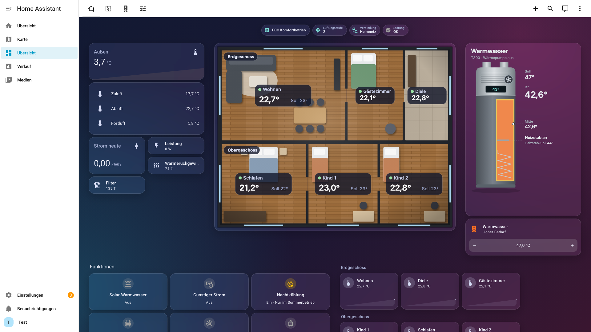
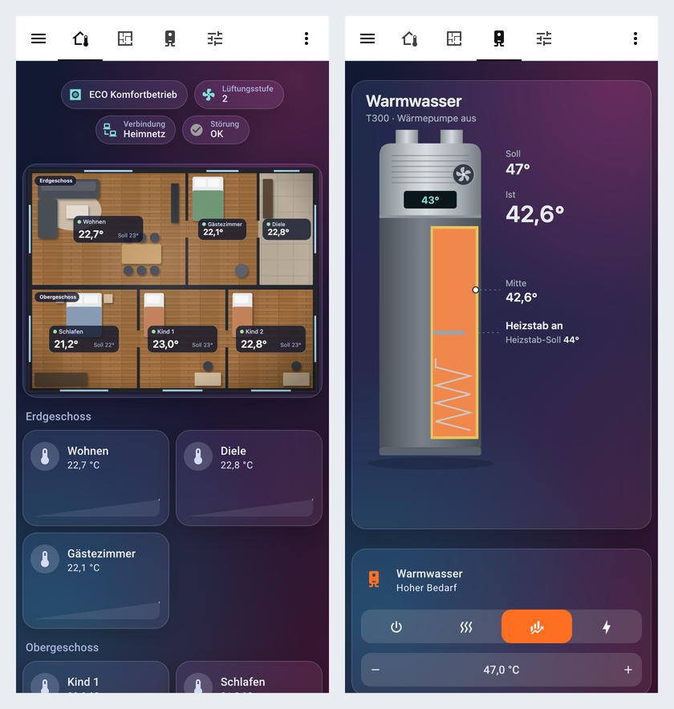
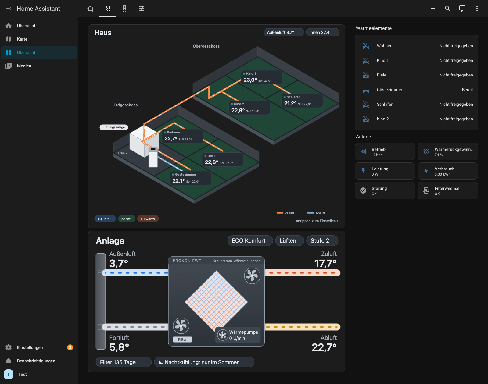
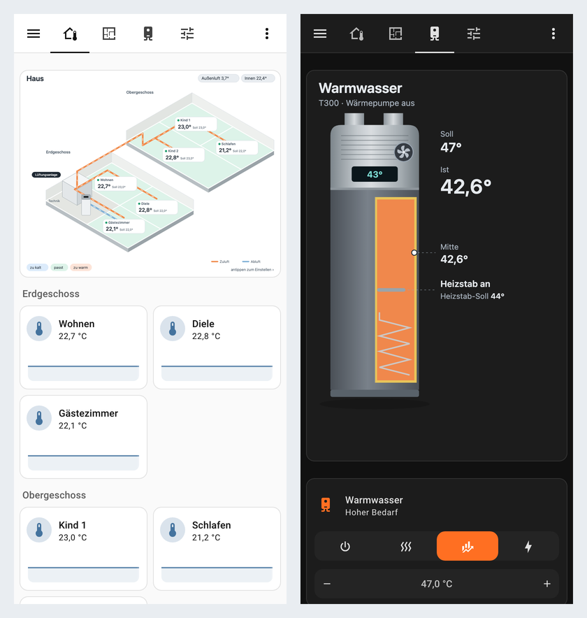

# Proxon Control for Home Assistant

Control and monitor a **Proxon** fresh-air heat/ventilation unit from Home Assistant: every connected room as its own thermostat, the ventilation as a fan (level 1–4, boost as preset),
hot water as a water heater, **hot water as a store for solar surplus and cheap electricity**, **summer night cooling**, a **hot-water boost** with the immersion heater, an **animated dashboard** (unit, hot water, house), the weekly ventilation schedule (view and edit), operating mode, CO₂/humidity limits and all readings. You log in with the same **Device ID and password** as in the
Proxon Control phone app. Every change is read back from the unit, and the polling interval is adjustable (5–3600 s). A diagnostics download helps with support.

**Home network first, cloud as fallback (new in 0.8.0).** Home Assistant talks to the unit directly in your home network (UDP port 5570, plain Python,
fast, keeps working when the internet is down) and falls back to Proxon's remote-access server when the unit can't be reached there. You can also choose
*home network only* or *Proxon server only*. A certificate is fetched once from the Proxon portal with your Device ID and password; after that the home
network connection needs no internet. Through the Proxon server it also works from elsewhere (no VPN or port forwarding needed).

**Unofficial.** This project is not made, endorsed or supported by Proxon or Nabto. "Proxon" and "Nabto" belong to their owners. It talks to the unit the
same ways the phone app does (in the home network, or through Proxon's remote-access server and Nabto's connection library), and may stop working if
those change. Use at your own risk. The home network protocol follows the [ha-lan-proxon](https://github.com/Fummy1990/ha-lan-proxon) project (MIT, see
[THIRD_PARTY_NOTICES.md](THIRD_PARTY_NOTICES.md)).

**Not included:** logos, images or texts of the original app, and Nabto's library. The library is downloaded from Nabto's own release on first use
(on Home Assistant OS also some Debian system files, see below). The small helper program that runs the library on Home Assistant OS is in `helper/`, its
source is included.

**Install:** HACS → three-dot menu → *Custom repositories* → `https://github.com/Olf1337/ha-proxon-control` (type *Integration*) → install → restart Home Assistant →
*Settings → Devices & services → Add integration → Proxon Control*.

**Raspberry Pi / ARM: supported from 0.8.0** over the home network (Home Assistant and the unit in the same network). The Proxon server fallback needs
Nabto's library, which only exists for Linux x86-64 (including Home Assistant OS on Intel/AMD) and macOS on Apple chips. The Proxon Bridge is no longer
needed on a Raspberry Pi; it stays for special cases (e.g. Home Assistant in a different network than the unit, on ARM).

**New in 0.16.0:** energy consumption per day, week, month and year (total, compressor, ventilation and electronics), and
the energy of ventilation and electronics as a counter of its own.

**New in 0.15.2:** the diagnostics download no longer contains the unit's IP address or the house photo; values of an FWT 3.0
(firmware 12) checked.

**New in 0.15.1:** a *read-only* option (show every value, never change anything on the unit; contributed by NicerDicerPro).

**New in 0.15.0:** *shower supply* (for how many minutes of showering the hot water lasts, also on the T300 picture);
*legionella protection with solar power* (the weekly heating to 60 °C on a day with solar surplus, after a week at the latest;
replaces the unit's own legionella function while on); *electricity cost* (with a price sensor in the options); a new dashboard tab
*Energy* (consumption and cost today / this week / month / year, per day and month, power, runtimes and compressor starts per day).

**New in 0.14.1:** the heat recovery sensor keeps its last measurement across a restart of Home Assistant (it can only measure
while the heat pump pauses, so in winter it stayed empty after an update).

**New in 0.14.0:** the "glass" dashboard: on tablets and computers a control panel with a schematic floor plan from above (rooms,
floors and furniture by the room names; temperature, target and a flame per room; tap a room for its thermostat), the T300 and the
functions; the theme "Proxon Glas" (frosted glass on a dark gradient) is installed by the action *Install glass theme*.

**New in 0.13.0:** a new dashboard: the house drawn isometric (ground and upper floor, ducts from the unit, every room coloured by
actual vs target with a flame while its heating element heats), the T300 drawn cut open (water coloured by its two sensors, immersion heater,
charge), a phone start page with your own house photo and the key values on it, room cards with 24-hour curves, a hot-water tab, and
an indoor average sensor. Choose the upper-floor rooms and the photo under *Configure*.

**New in 0.12.0:** heat demand per room as in the Proxon app (thermostat shows heating when the element is released and the room
too cold), "heating elements heating" with active channels, compressor power in %, device type (no cooling switch on heating-only units).

**New in 0.11.0:** automatic summer/winter switching (by the 2-day outdoor average), runtime statistics (lifetime hour counters,
starts and runtime today, short-cycling notice), night setback settings, hot-water module faults by name.

**New in 0.10.0:** power draw (total, compressor, ventilation) and energy counters (kWh) for the Energy dashboard; weekly schedule phases
across midnight are understood.

**New in 0.9.0:** stove mode, legionella protection, boost duration, filter lifetime as set at the unit, hot-water charge, heat recovery,
current operation, PV input, bypass and more diagnostics; every room as its own device (assignable to an area), the weekly schedule as time/level
settings with "copy Monday" buttons, a write guard while the unit reports a fault, a clock deviation notice, and new blueprints (stove, outdoor air,
nobody home).

**Upgrading to 0.3.2:** room thermostats now use the modes `auto` (unit regulates the room) and `heat` (electric heating element released) instead of `off`/`heat`; up to 20 rooms are supported.

**Upgrading from 0.1.x:** rooms are now thermostats (`climate` entities). The old room numbers and switches are removed on start; update automations and dashboards that used them.

---

# Proxon Control – Integration für Home Assistant (Version 0.16.0)

Bringt die Proxon-Anlage (Frischluft-Wärmetechnik) als eigenes Gerät in Home Assistant – mit derselben
Anmeldung wie die App „Proxon Control“: **Device ID + Passwort**.

> ### Heimnetz zuerst, Proxon-Server als Ausweichweg (neu in 0.8.0)
> Die Integration spricht die Anlage **direkt im Heimnetz** an (schnell, funktioniert auch ohne Internet, auch auf dem **Raspberry Pi**). Ist sie dort
> nicht erreichbar, nimmt sie automatisch den **Proxon-Server** – denselben Fernzugriff wie die Proxon-App. Damit funktioniert sie weiterhin auch von außerhalb
> des Heimnetzes, ohne VPN und Portfreigabe. Wer möchte, stellt „Nur Heimnetz“ oder „Nur Proxon-Server“ ein.

Danach gibt es in Home Assistant unter *Einstellungen → Geräte & Dienste → Proxon Control* ein Gerät „Proxon“ mit:

| Art | Entitäten |
|---|---|
| Thermostate | **Jeder angeschlossene Raum als eigenes Gerät mit Thermostat und Temperatur** (einem Bereich zuordenbar) (bis zu 20 Nebenräume, wie die Anlage sie meldet): Ist- und Soll-Temperatur, Modus „Wärmeelement aus“ oder „Wärmeelement freigegeben“, Sensor „Wärmeelement“ (nicht freigegeben / bereit / heizt), und was die Anlage gerade macht (Heizen / Kühlen / Lüften). Wohnzimmer 10–30 °C in 0,5-°C-Schritten, andere Räume 14–26 °C in ganzen Grad (± 3 °C um den eigenen Grundwert des Raums) |
| Lüftung | **Als Ventilator**: Stufe 1–4 als Geschwindigkeit (25/50/75/100 %), Intensivlüftung als Voreinstellung „Intensivlüftung“. Passt zu den Ventilator-Karten und zu Sprachassistenten. Ausschalten geht nur über die Betriebsart „Aus“ (das würde die ganze Anlage ausschalten) |
| Warmwasser | **Als Warmwasserbereiter**: Ist- und Soll-Temperatur (20–55 °C) und Betriebsart Aus / Wärmepumpe / Wärmepumpe + E-Heizstab / nur E-Heizstab (nur mit Warmwasser-Wärmepumpe T300) |
| Wochenprogramm | **Lüftungs-Zeitprogramm der Anlage**: je Wochentag ein Sensor („06:00–08:00 Stufe 2 · 17:00–22:00 Stufe 3“, die drei Phasen als Attribute), „Zeitprogramm aktiv“, Uhr der Anlage. Bearbeiten direkt in den Geräten „Proxon Zeitprogramm Montag“ … „Sonntag“ (je Phase Beginn, Ende, Lüftungsstufe), Knöpfe „Montag → Di–Fr / alle Tage“, oder über die Aktionen *Zeitprogramm-Phase setzen* und *Zeitprogramm-Tag kopieren* |
| Auswahl | Betriebsart (ECO Komfort, Winter, Sommer, Ofenbetrieb, Aus; Urlaub wird angezeigt) |
| Zahlen (Schieberegler) | Lüftungsstufe 1–4, Grenzwert CO₂ 400–1500 ppm (nur mit CO₂-Sensor), Grenzwert Feuchte 0–100 %, Warmwasser 20–55 °C, E-Heizstab 20–70 °C, Dauer der Intensivlüftung |
| Schalter | Intensivlüftung, Kühlung, Warmwasser-Wärmepumpe, E-Heizstab, Legionellenschaltung |
| Sensoren | Raumtemperaturen, Innen (Mittel aller Räume), Frisch-/Zu-/Ab-/Fortluft, Warmwasser, Drehzahlen, CO₂, Feuchte, Lüftungsstufe (Ist), Restzeit Intensivlüftung, Restlaufzeit Filter (nach der an der Anlage eingestellten Standzeit), Betriebsstunden, 4-Wegeventil, Firmware, Warmwasser unten, Warmwasser-Ladezustand, Duschvorrat, Aktueller Betrieb, Wärmerückgewinnung, Stromkosten (mit Preis-Sensor) |
| Meldungen | „Filterwechsel bald nötig“, „Kompressor läuft“, „Störung“ (Fehlerwörter der Anlage als Attribute), Bypass, Erdwärmetauscher, PV-Eingang; Filterwechsel, Störung und eine falsch gehende Anlagenuhr erscheinen zusätzlich unter *Einstellungen → Reparaturen* |
| Urlaubsmodus | Schalter: Lüftung Stufe 1, Wohnzimmer 18 °C, übrige Räume −3 °C, Wärmeelemente aus, Warmwasser aus – beim Ausschalten werden die vorherigen Werte wiederhergestellt |
| Diagnose | Antwortzeit der Anlage, Verbindungsweg (Heimnetz / direkt über das Internet / über Vermittlungsserver; im Heimnetz exakt, über den Proxon-Server geschätzt), Uhr der Anlage und ihre Abweichung, Firmware (auch des Warmwasser-Moduls), Betriebsstunden, letzter Schreibfehler, Temperaturen, Druck und Ventile des Kältekreises |

## Neu in Version 0.16.0: Energieverbrauch nach Zeitraum

* **Verbrauch heute, diese Woche, diesen Monat und dieses Jahr** als eigene Sensoren, jeweils für
  * den **gesamten** Verbrauch der Anlage,
  * den **Kompressor** (die Wärmepumpe der Lüftungsanlage: Heizen und Kühlen der Zuluft),
  * **Lüftung und Elektronik** (neu auch als fortlaufender Zähler „… gesamt“).

  Gesamt ist Kompressor plus Lüftung und Elektronik. Der Warmwasserspeicher T300 meldet keine Leistung und ist nicht
  enthalten. Die Zeiträume richten sich nach der Ortszeit (die Woche beginnt am Montag) und fangen jeweils wieder bei 0 an;
  nach einem Neustart zählen sie weiter. Direkt nach dem Update beginnen sie bei 0, die Kacheln im Energie-Tab zeigen
  weiterhin die Werte aus der Statistik von Home Assistant.
* Die fortlaufenden Zähler heißen jetzt „Energieverbrauch gesamt“ und „Energieverbrauch Kompressor gesamt“ (nur der
  angezeigte Name; Entity-IDs, Automationen und Dashboards bleiben gleich).
* Energie-Tab: Die Balken pro Tag zeigen zusätzlich Lüftung und Elektronik (Dashboard neu erstellen).

## Neu in Version 0.15.2

* **Diagnose ohne IP-Adresse:** Die IP-Adresse der Anlage (und das Hausfoto) werden aus dem Diagnose-Download entfernt.
  Bisher blieb die eingetragene Heimnetz-Adresse darin stehen. Wer schon eine Diagnosedatei öffentlich geteilt hat:
  Es ist nur die interne Adresse im Heimnetz, von außen nicht erreichbar.
* **FWT 3.0 (Firmware 12):** Mit der Diagnose einer FWT 3.0 geprüft: Werte, Räume und Verbindung im Heimnetz passen. Die
  Raumpanels melden dort im LED-Feld einen anderen Wert als die FWT 2.0; ob ein Raum zu kalt ist, wird dann wie beim
  Wohnzimmer aus Temperatur und Soll bestimmt.

## Neu in Version 0.15.1: Nur lesen

* **Option „Nur lesen“** (beigetragen von NicerDicerPro): Alle Werte werden wie gewohnt gelesen, aber Home Assistant ändert nichts an der
  Anlage. Jede Änderung wird mit einer Meldung abgelehnt, die automatischen Funktionen bleiben untätig. Einzuschalten unter *Geräte &
  Dienste → Proxon Control → Konfigurieren*. Mehr unter „Nur lesen“ weiter unten.
* Hinweis für Home Assistant in Docker Desktop: dort die IP-Adresse der Anlage eintragen (siehe Fehlersuche).

## Neu in Version 0.15.0: Duschvorrat, Legionellenschutz mit Sonne, Energie-Tab

* **Duschvorrat** (Sensor, auch im T300-Bild): Für wie viele Minuten Duschen das Warmwasser noch reicht (40 °C an der
  Brause, 8 Liter pro Minute), in 5-Minuten-Schritten. Gerechnet aus den Fühlern Mitte und unten: die obere Hälfte des
  Speichers mit der Temperatur in der Mitte, die untere mit der unten; nur Wasser über 40 °C zählt. Eine Schätzung, denn der
  Speicher hat oben keinen Fühler.
* **Legionellenschutz mit Sonne** (Schalter, Status-Sensor): Einmal pro Woche muss das Warmwasser auf 60 °C. Statt der
  eigenen Legionellenschaltung der Anlage (feste Uhrzeit, oft mit Netzstrom) heizt der Heizstab an einem Tag mit
  Solarüberschuss:
  * Ab dem 5. Tag nach dem letzten Mal wird auf Sonne gewartet. Der Überschuss muss 10 Minuten über der Schwelle von
    „Solar-Warmwasser“ liegen.
  * Nach 7 Tagen heizt er trotzdem.
  * Dafür wird der Heizstab-Sollwert auf 60 °C gesetzt und der Heizstab eingeschaltet. Fertig ist er, wenn die Mitte 60 °C
    erreicht, spätestens nach 4 Stunden (dann neuer Versuch nach 12 Stunden). Danach werden Sollwert und Heizstab wieder
    wie vorher eingestellt.
  * Wird das Wasser von allein so heiß, zählt das auch.
  * Pause im Urlaubsmodus.
  * Solange der Schalter an ist, ist die Legionellenschaltung der Anlage aus; beim Ausschalten wird sie wieder eingeschaltet,
    wenn sie vorher an war.
* **Stromkosten** (Sensor, nur wenn in den Optionen ein Strompreis-Sensor gewählt ist): Was die Anlage gekostet hat,
  aufsummiert aus Leistung × Preis im jeweiligen Moment.
* **Neuer Dashboard-Tab „Energie“** im Glas-Design:
  * Verbrauch und Kosten heute, diese Woche, diesen Monat und dieses Jahr,
  * Balken pro Tag (30 Tage) und pro Monat,
  * die Leistung der letzten 24 Stunden,
  * Laufzeiten und Kompressor-Starts pro Tag.

  Die Balken füllen sich mit der Zeit: Home Assistant legt die Tageswerte stündlich an. Zum Übernehmen das Dashboard neu
  erstellen (Aktion „Dashboard erstellen“ und den Inhalt im Raw-Konfigurationseditor ersetzen).

## Neu in Version 0.14.1

* **Wärmerückgewinnung bleibt nach einem Neustart erhalten.** Der Sensor kann nur messen, wenn der Kompressor steht (sonst
  wärmt die Wärmepumpe die Zuluft mit). Im Winter läuft er fast durchgehend, deshalb blieb der Sensor nach einem Neustart von
  Home Assistant (z. B. nach einem Update) lange leer. Jetzt wird der letzte Messwert samt Zeitpunkt übernommen. Ob gerade
  gemessen werden kann, zeigt das Attribut `measuring_now`.

## Neu in Version 0.14.0: Glas-Dashboard mit Grundriss

* **Startseite auf Tablet und Computer** (ab 1024 px Breite) als Bedientafel:
  * links Außentemperatur mit Verlauf, Zu-, Ab- und Fortluft, Strom heute, Leistung, Wärmerückgewinnung und Filter,
  * in der Mitte der **Grundriss von oben**,
  * rechts der T300 mit Solltemperatur,
  * darunter die Funktionen als große Kacheln und die Räume mit ihren Kurven.

  Ist weniger Platz, ordnen sich die Abschnitte selbst um (drei oder zwei Spalten).
* **Der Grundriss ist schematisch gezeichnet**, nicht dein echter Grundriss: Größe, Boden (Holz, Fliesen, Stein) und Möbel jedes Raums
  ergeben sich aus seinem Namen (Wohnzimmer mit Sofa und Esstisch, Schlafzimmer mit Bett, Bad mit Wanne …), dazu Wände mit Türen und
  Fenstern, Erd- und Obergeschoss untereinander. Auf jedem Raum stehen Ist, Soll und die Flamme, solange sein Wärmeelement heizt; zu
  kalte Räume sind blau, zu warme orange umrandet. **Jeder Raum lässt sich antippen** und öffnet sein Thermostat.
* **Auf dem Handy** bleibt die Startseite aus 0.13.0: dein Hausfoto (ohne Foto jetzt der Grundriss), die Raumkarten, die Funktionen.
* **Glas-Look für das ganze Dashboard:** neues Theme „Proxon Glas“ (Milchglas-Karten auf dunklem Farbverlauf). Installiert wird es mit
  der Aktion **„Proxon Control: Glas-Theme installieren“** (*Entwicklerwerkzeuge → Aktionen*). Sie legt das Theme im Ordner `themes`
  ab, lädt die Themes neu und stellt die Dashboard-Bilder auf dunkel. Alle Reiter des fertigen Dashboards nutzen das Theme.
  * Kopfzeile und Seitenleiste bleiben im normalen Theme. Auf einem Wandtablet wählst du „Proxon Glas“ im Profil, dann ist alles im
    Glas-Look.
  * Lädt Home Assistant den Ordner `themes` nicht, sagt die Antwort der Aktion, welche Zeile in `configuration.yaml` fehlt
    (`themes: !include_dir_merge_named themes` unter `frontend:`; in der Standard-Konfiguration ist sie schon da).
* Oben auf der Startseite: Betriebsart, Lüftungsstufe, Verbindung und Störung als Plaketten. Neues Bild-Entity „Bild Grundriss“.

**Nach dem Update:**
1. Home Assistant **neu starten** (erst dann ist der neue Code aktiv).
2. Einmal die Aktion **„Proxon Control: Glas-Theme installieren“** ausführen.
3. Das Dashboard neu erzeugen: „Proxon Control: Dashboard erstellen“ → Antwort kopieren → im Dashboard ✏️ → ⋮ →
   *Raw-Konfigurationseditor* → Inhalt ersetzen.

## Neu in Version 0.13.0: Neues Dashboard mit Haus im Schnitt und T300

* **Haus isometrisch:** Erdgeschoss vorne, Obergeschoss dahinter, jeder Raum mit Ist- und Solltemperatur, gefärbt nach Ist gegenüber Soll
  (blau zu kalt, grün passt, orange zu warm) und mit flackernder Flamme, solange sein Wärmeelement heizt. Im Technikraum stehen die
  Lüftungsanlage und der T300; von dort laufen die Zuluftleitungen in jeden Raum (auch hinauf ins Obergeschoss) und die Abluft zurück –
  die Luft strömt, solange die Lüftung läuft. Bei vielen Räumen wählt die Integration selbst Raster und Beschriftungsgröße, damit sich
  nichts überdeckt. **Jeder Raum lässt sich antippen** und öffnet sein Thermostat.
* **T300 im Schnitt:** der Speicher aufgeschnitten, das Wasser gefärbt nach den beiden Fühlern (Mitte, unten), Wärmetauscher-Wendel,
  Heizstab (glüht, solange sein Relais an ist), Lüfter der Wärmepumpe (dreht sich, solange der Verdichter läuft), daneben Soll, Ist,
  Ladezustand und Heizstab.
* **Startseite fürs Handy:** oben **dein eigenes Hausfoto** mit Außen-, Innen- und Warmwassertemperatur und dem aktuellen Betrieb
  darauf (ohne Foto das gezeichnete Haus), darunter jeder Raum als Karte mit seiner Temperaturkurve der letzten 24 Stunden – nach Etagen
  getrennt, antippen öffnet das Thermostat –, daneben Lüftung, Betriebsart, Warmwasser und die Funktionen.
* **Vier Reiter:** *Zuhause*, *Haus* (Haus und Anlage groß, Wärmeelemente je Raum, Werte der Anlage), *Warmwasser* (T300, Betriebsart
  und Solltemperatur, Verlauf der letzten 24 Stunden, Schalter) und *Einstellungen* wie bisher.
* **Neuer Sensor „Innen (Mittel)“:** die mittlere Temperatur aller Räume mit Bedienteil.
* **Neue Einstellungen** unter *Proxon Control → Konfigurieren*: **Räume im Obergeschoss** (vorausgewählt nach den Namen wie Schlaf- oder
  Kinderzimmer – nichts auswählen bei einem Bungalow) und **Hausfoto** (z. B. `/config/www/proxon/haus.jpg` ablegen und
  `/local/proxon/haus.jpg` eintragen).

**Dashboard aktualisieren:** *Entwicklerwerkzeuge → Aktionen* → „Proxon Control: Dashboard erstellen“ → Antwort kopieren → im Dashboard
✏️ → ⋮ → *Raw-Konfigurationseditor* → Inhalt ersetzen. Der Verlauf in den Raumkarten und auf der Warmwasser-Seite braucht die
Verlauf-Integration (ist bei normalen Installationen dabei).

## Neu in Version 0.12.3

* **„Heizt“ wie die Anlage es entscheidet:** Die Anlage schaltet ein freigegebenes Wärmeelement zu, wenn der Raum um ihre
  *Einschaltschwelle* unter dem Sollwert liegt, und erst wieder ab, wenn er bis auf die *Ausschaltschwelle* aufgeholt hat. Beide Schwellen
  werden jetzt gelesen (Diagnose-Sensoren „Wärmeelemente Einschaltschwelle / Ausschaltschwelle“, Proxons Modbus-Liste 4x0317/4x0318), und der
  Sensor „Wärmeelement“ rechnet damit (Attribute `below_target` und `decided_by`). Liefert die Anlage keine plausiblen Schwellen, zählt wie
  bisher die Anzeige des Raum-Bedienteils.

## Neu in Version 0.12.2

* **Wärmeelement je Raum mit drei Zuständen:** neuer Sensor „Wärmeelement“ im Gerät jedes Raums – *Nicht freigegeben*, *Bereit*
  (freigegeben, der Raum braucht keine Wärme) oder *Heizt* (freigegeben und der Raum zu kalt, wie die Proxon-App es zeigt). Welches Relais
  wirklich schaltet, meldet die Anlage nur je Kanal, nicht je Raum.
* Die Thermostat-Modi heißen jetzt **„Wärmeelement aus“** und **„Wärmeelement freigegeben“** (vorher „Automatik (Wärmepumpe)“ und
  „Mit Wärmeelement“) – die Wärmepumpe regelt in beiden Fällen weiter.

## Neu in Version 0.12.1 (Verbesserungen aus einer Code-Prüfung)

* Die **Filter-Erinnerung des Warmwasser-Moduls** gilt nicht mehr als Störung: Sie steht weiter im Sensor „Störung“ (Attribut
  `hot_water_module`), sperrt aber keine Änderungen mehr und erzeugt keinen Störungs-Hinweis.
* **Wochenprogramm kopieren** übernimmt jetzt auch Phasen über Mitternacht (z. B. 21:01–06:00), die die Anlage schon gespeichert hat.
* **Sommer/Winter-Automatik:** Eine von Hand gewählte Betriebsart (Bedienpanel, App oder Home Assistant) bleibt 12 Stunden bestehen,
  statt gleich zurückgestellt zu werden.
* **„Heimnetz zuerst“:** Fällt nach einem kurzen Aussetzer im Heimnetz auch der Proxon-Server aus, wird das Heimnetz trotzdem versucht –
  die Anlage bleibt erreichbar.
* Der Schlüssel des Heimnetz-Zertifikats wird von Anfang an nur für den eigenen Benutzer lesbar angelegt.
* Die Raumnamen werden nur noch etwa alle 5 Minuten gelesen (bei neuen Räumen sofort) – weniger Anfragen an die Anlage.
* Für Entwickler: Codeprüfung mit Ruff, mypy und Bandit läuft bei jeder Änderung mit; Testwerkzeuge sind festgelegt und werden über Dependabot aktuell gehalten.

## Neu in Version 0.12.0

* **Wärmebedarf je Raum wie in der Proxon-App:** Jedes Raum-Bedienteil meldet, ob der Raum zu kalt, am Sollwert oder wärmer ist
  (Attribut `heat_demand` am Thermostat). Ist das Wärmeelement freigegeben und der Raum zu kalt, zeigt das Thermostat „Heizt“ und das
  Hausbild die Flamme – wie die App. (Beim zentralen Bedienteil wird dafür Ist- mit Soll-Temperatur verglichen.)
* **„Wärmeelemente heizen“:** ob die elektrischen Wärmeelemente gerade wirklich heizen, mit den eingeschalteten Kanälen K1–K10 als Attribut
  (welcher Kanal zu welchem Raum gehört, steht im Verkabelungsplan der Anlage).
* **Kompressor-Leistung** in % und **Gerätetyp** (nur Heizen / Heizen und Kühlen); bei Anlagen ohne Kühlung entfällt der Kühlschalter.
* Idee und Bedeutung der Werte nach dem Projekt [ha-modbus-proxon](https://github.com/charly166/ha-modbus-proxon) (kein Code übernommen).

## Neu in Version 0.11.0

* **Automatische Sommer/Winter-Umschaltung** (Schalter, standardmäßig aus): Die Integration wechselt die Betriebsart nach der mittleren
  Außentemperatur der letzten zwei Tage – unter „Winter unter“ (Standard 14 °C) auf Winter, über „Sommer über“ (Standard 17 °C) auf Sommer,
  dazwischen bleibt alles, höchstens alle 12 Stunden ein Wechsel. Nur wenn die Anlage in Sommer oder Winter läuft; ECO Komfort, Aus,
  Ofenbetrieb und Urlaub bleiben unberührt. Die Außentemperaturen werden schon gesammelt, solange der Schalter aus ist.
* **Laufzeit-Statistik:** Betriebsstunden der Anlage einzeln (Kompressor Heizen / Kühlen, Abtauen, Vorwärmung, jede Lüftungsstufe;
  Warmwasser-Kompressor und Heizstab) und für heute Starts und Laufzeit von Kompressor, Warmwasser-Kompressor und Heizstab (gestern als
  Attribut). Startet der Kompressor an einem Tag 30-mal oder öfter, erscheint ein Hinweis unter *Reparaturen* (Takten).
* **Nachtabsenkung** der Anlage: an/aus, Beginn, Ende und Nachttemperatur ablesen und einstellen (eigenes Zeitprogramm der Anlage).
* **Störungen des Warmwasser-Moduls im Klartext** (z. B. „Filter wechseln“, „Niederdruck“, „Fühler T20 (Speicher unten)“) – im Sensor
  „Störung“ (Attribut `hot_water_module`) und im Hinweis unter *Reparaturen*. Für die Hauptanlage nennt Proxons Liste keine Texte.
* Adressen aus Proxons Modbus-Liste (FWT 2.0). Die Nachtabsenkung schreibt nach demselben Schema wie das Wochenprogramm; jede Änderung
  wird von der Anlage zurückgelesen und sonst als Fehler gemeldet.

## Neu in Version 0.10.0

* **Stromverbrauch der Anlage:** Leistungsaufnahme gesamt, des Kompressors und von Lüftung und Elektronik (W), direkt von der Anlage gemessen,
  und daraus **Energieverbrauch** gesamt und Kompressor (kWh). Die kWh-Sensoren lassen sich im **Energie-Dashboard** unter
  *Einzelne Geräte* eintragen. Das Warmwasser-Modul ist darin nicht enthalten. (Adressen aus Proxons Modbus-Liste, an einer echten Anlage geprüft.)
* **Wochenprogramm: Phasen über Mitternacht** (z. B. 21:01–06:00, an der Anlage eingestellt) werden jetzt richtig verstanden. Bisher ließ sich
  an solchen Tagen keine Phase ändern. Neue Phasen über Mitternacht legt die Integration weiterhin nicht selbst an.
* Die Arbeitszahl (COP) aus der Modbus-Liste meldet die Anlage über das Netz nicht (bleibt 0); sie wird daher nicht angeboten.

## Neu in Version 0.9.1

* **„Aktueller Betrieb“ korrigiert:** Die in 0.9.0 gelesene Adresse blieb an einer echten Anlage auf „Lüften“, obwohl der Kompressor lief.
  Der Wert ergibt sich jetzt aus Kompressor und 4-Wege-Ventil und stimmt damit immer.
* **Prüfwerte in der Diagnose-Datei:** Einige Werte aus Proxons Modbus-Liste (Leistungsaufnahme, Luftmenge, Arbeitszahl, Störungs-Sammelmeldung)
  werden zusätzlich gelesen und nur in die Diagnose-Datei geschrieben (`Pruefwert_DP0_…`). Damit lässt sich an einer echten Anlage klären, welche
  Adresse was enthält, bevor daraus Sensoren werden.

## Neu in Version 0.9.0

**Neue Einstellungen und Werte** (Adressen wie im Projekt [ha-lan-proxon](https://github.com/Fummy1990/ha-lan-proxon) dokumentiert):

* **Ofenbetrieb** als Betriebsart: Bei Kamin oder Kaminofen hält die Anlage einen leichten Überdruck, damit kein Rauch in den Raum gezogen wird.
* **Legionellenschaltung** des Warmwasser-Moduls als Schalter, **Dauer der Intensivlüftung** einstellbar.
* **Filter-Restlaufzeit nach der Standzeit, die an der Anlage eingestellt ist** (3–8 Monate). Bisher wurde fest mit 6 Monaten gerechnet –
  wer eine kürzere Standzeit eingestellt hat, bekam den Hinweis „Filterwechsel bald nötig“ zu spät.
* **Warmwasser unten** (zweiter Fühler im Speicher) und daraus der **Warmwasser-Ladezustand** in % (geschätzt).
* **Aktueller Betrieb** (Lüften / Heizen / Kühlen), aus Kompressor und 4-Wege-Ventil (wie die Statuszeile der App).
* **Wärmerückgewinnung** in %: wie viel Wärme der Wärmetauscher aus der Abluft zurückholt. Messbar nur, wenn die Wärmepumpe aus und der Bypass
  zu ist und außen und innen mindestens 5 °C Unterschied herrschen; dazwischen bleibt der letzte Messwert stehen. Sinkt der Wert über die Zeit,
  sind oft Filter oder Wärmetauscher verschmutzt.
* **PV-Eingang** des Warmwasser-Moduls (freigegeben, Signal Heizstab / Wärmepumpe), **Bypass**, **Erdwärmetauscher**, Magnetventil, Bedienpanel gesperrt.
* Diagnose: Temperaturen und Druck des Kältekreises, Ventile, Schieberposition, Firmware des Warmwasser-Moduls (Statuswörter abgeschaltet, bei Bedarf einschalten).

**Bedienung und Sicherheit:**

* **Jeder Raum ist ein eigenes Gerät** („Proxon Schlafzimmer“) mit Thermostat und Temperatur. Gibt es einen Bereich mit dem Namen des Raums, landet
  das Gerät beim ersten Start automatisch dort; sonst einfach im Gerät den Bereich wählen. Danach klappt z. B. „Schlafzimmer auf 21 Grad“ per Sprache.
  Die Entitäts-IDs bleiben gleich.
* **Wochenprogramm als Eingabefelder:** je Wochentag ein Gerät „Proxon Zeitprogramm Montag“ … mit Beginn, Ende und Lüftungsstufe jeder Phase,
  dazu die Knöpfe „Montag → Dienstag bis Freitag“ und „Montag → alle Tage“. Es gelten dieselben Regeln der Anlage wie bisher; eine ausgeschaltete
  Phase kann frei vorbereitet werden.
* **Schutz bei Störung:** Meldet die Anlage eine Störung, schreibt die Integration nur noch Harmloses (Ausschalten, Lüftungsstufe, Raumtemperaturen).
  Der Sensor **Letzter Schreibfehler** zeigt, wann und warum eine Änderung nicht übernommen wurde.
* **Uhr der Anlage:** Sensor „Uhrabweichung“ und ein Hinweis unter *Reparaturen*, wenn die Uhr mehr als 10 Minuten falsch geht
  (das Wochenprogramm richtet sich nach ihr; stellen lässt sie sich nur an der Anlage oder in der App).

**Neue Blueprints** (*Einstellungen → Automationen → Blueprints → Blueprint importieren*, Adresse der Datei in `blueprints/automation/proxon_control/`):

* **Kaminofen** (`stove_mode.yaml`): Ofen brennt → Ofenbetrieb, danach zurück in die gewählte Betriebsart.
* **Schlechte Außenluft** (`outdoor_air.yaml`): Pollen, Feinstaub, Rauch über der Grenze → Lüftung Stufe 1, danach wieder normal.
* **Niemand zu Hause** (`nobody_home.yaml`): Lüftung Stufe 1, beim Heimkommen wieder normal.
* **Bad nach dem Duschen** (`humidity_boost.yaml`, erweitert): startet die Intensivlüftung jetzt auf Wunsch erneut, solange es noch zu feucht ist.

Hinweis: Ofenbetrieb, Legionellenschaltung und Dauer der Intensivlüftung schreiben in die Anlage. Die Adressen sind bei ha-lan-proxon an einer Anlage
mit Firmware 7.4 / Warmwasser-Modul 3.5 geprüft; jede Änderung wird – wie immer – von der Anlage zurückgelesen und sonst als Fehler gemeldet.

## Neu in Version 0.8.0: Direkt im Heimnetz, auch auf dem Raspberry Pi

* **Heimnetz zuerst, Proxon-Server als Ausweichweg.** Die Integration spricht die Anlage direkt im Heimnetz an (UDP-Port 5570, reines Python, keine
  Nabto-Bibliothek, kein Hilfsprogramm). Antwortet sie dort nicht, geht es über den Proxon-Server weiter; nach 10 Minuten wird das Heimnetz erneut versucht.
* **Raspberry Pi und andere ARM-Systeme** werden unterstützt (über das Heimnetz). Die Proxon-Bridge ist dafür nicht mehr nötig.
* **Verbindung wählbar** beim Einrichten und unter *Konfigurieren*: „Heimnetz zuerst“ (Standard), „Nur Heimnetz“, „Nur Proxon-Server“. Optional die
  IP-Adresse der Anlage, falls sie nicht automatisch gefunden wird (anderes Subnetz/VLAN).
* **Zertifikat einmalig:** Beim ersten Verbinden im Heimnetz holt die Integration – wie die Original-App beim ersten Anmelden – mit Device ID und Passwort
  ein Zertifikat vom Proxon-Portal. Danach braucht die Heimnetz-Verbindung kein Internet mehr. Der Schlüssel bleibt auf Ihrem Home Assistant
  (`/config/proxon_control/local/`). Die Anlage selbst muss das Zertifikat einmal online gelernt haben.
* **Verbindungsweg exakt:** Läuft die Verbindung über das Heimnetz, zeigt der Diagnose-Sensor das sicher an (Attribut `estimated: false`);
  über den Proxon-Server bleibt er geschätzt.
* Bestehende Installationen nutzen nach dem Update automatisch „Heimnetz zuerst“.
* Das Heimnetz-Protokoll folgt dem Projekt [ha-lan-proxon](https://github.com/Fummy1990/ha-lan-proxon) (MIT-Lizenz, siehe [THIRD_PARTY_NOTICES.md](THIRD_PARTY_NOTICES.md)) – danke!

## Neu in Version 0.6.0 / 0.7.0

### Dashboard mit Bildern von Anlage, Warmwasser und Haus

Die Integration zeichnet drei Bilder aus den aktuellen Werten – als Bild-Entitäten, die sich mit den Werten aktualisieren:

* **Anlage:** Kreuzstrom-Wärmetauscher mit den vier Luftströmen (Außen-, Zu-, Ab-, Fortluft), Lüftern, Filter und Wärmepumpe. Die Lüfter drehen sich,
  solange die Lüftung läuft (schneller bei höherer Stufe), die Luft strömt durch die Kanäle, der Wärmepumpen-Lüfter dreht sich, wenn der Kompressor läuft.
  Darunter: Filter-Restlaufzeit und – wenn eingeschaltet – Nachtkühlung, Intensivlüftung oder eine Störung.
* **Warmwasser:** der T300 im Schnitt (seit 0.13.0, siehe oben), mit Heizstab, Wärmepumpe und – wenn eingeschaltet – Solar-/Strompreis-Warmwasser und Boost.
* **Haus:** isometrisch mit Erd- und Obergeschoss (seit 0.13.0, siehe oben) – gefärbt nach Ist gegenüber Soll (blau zu kalt, grün passt, orange zu warm),
  mit flackernder Flamme, solange das Wärmeelement des Raums heizt.

Die Bilder haben keinen eigenen Hintergrund und passen sich **hell/dunkel** an (wie das anzeigende Gerät; fest hell oder dunkel unter
*Proxon Control → Konfigurieren → Dashboard-Bilder*). Neue Temperaturen werden höchstens einmal pro Minute gezeichnet (sonst würden die Animationen
ständig neu starten), Umschalten (Betriebsart, Stufe, Heizstab, Funktionen) sofort.

**Das fertige Dashboard** (nur eingebaute Karten) hat seit 0.13.0 vier Reiter (*Zuhause*, *Haus*, *Warmwasser*, *Einstellungen*, siehe oben).
**Die Bilder lassen sich antippen:** die Anlage öffnet die Lüftung, der Speicher das Warmwasser, **jeder Raum sein Thermostat** (Solltemperatur,
Wärmeelement). Die Funktionen (Solar-Warmwasser, Günstiger Strom, Nachtkühlung, Warmwasser-Boost, Urlaubsmodus, Intensivlüftung) zeigen neben An/Aus,
was sie gerade tun – z. B. „Ein · Heizt mit Solarstrom“. Der Urlaubsmodus fragt vor dem Umschalten nach. Unter *Einstellungen* stehen alle
Schwellwerte mit +/–, das Wochenprogramm der Lüftung (Montag–Sonntag), die Laufzeiten und die Diagnose.

Auf breiten Bildschirmen zwei Spalten, auf dem Handy alles untereinander.

**Einrichten (einmalig):**
1. *Entwicklerwerkzeuge → Aktionen* → **„Proxon Control: Dashboard erstellen“** → *Aktion ausführen* → die **ganze Antwort** kopieren (sie beginnt mit `views:`).
2. *Einstellungen → Dashboards → Dashboard hinzufügen → Neues Dashboard von Grund auf*, öffnen → ✏️ → ⋮ → **Raw-Konfigurationseditor** → Inhalt ersetzen → Speichern.

Das Dashboard enthält die tatsächlichen Entitäts-IDs deiner Anlage (auch mit Bereichs-Präfix wie `hwr_`) und nur das, was deine Anlage hat.
Nach einem Update mit neuem Dashboard-Aufbau einfach die Aktion noch einmal ausführen und den Inhalt erneut ersetzen.

### Warmwasser als Speicher für Solarstrom und günstigen Strom

Der Warmwasserspeicher wird zur „Batterie“: Bei Solarüberschuss oder günstigem Strom hebt die Integration den Warmwasser-Sollwert an
(z. B. 46 → 55 °C), die Warmwasser-Wärmepumpe heizt den Speicher mit diesem Strom auf. Danach wird der vorherige Sollwert wiederhergestellt.

**Einrichten:** *Geräte & Dienste → Proxon Control → Konfigurieren* – dort den Sensor für den **Solarüberschuss** (eingespeiste Leistung in W/kW,
z. B. Netzleistung des Wechselrichters oder Smart Meters; Haken setzen, wenn Einspeisung negativ angezeigt wird) und/oder den Sensor für den
**Strompreis** (dynamischer Tarif, ct/kWh, €/kWh oder €/MWh, z. B. EPEX Spot, Tibber, Nord Pool) auswählen.

**Bedienen** auf der Geräteseite „Proxon“ (unter *Konfiguration*):

| Entität | |
|---|---|
| **Solar-Warmwasser** (Schalter) | Solarüberschuss nutzen an/aus |
| **Solar-Überschuss ab** (W) | ab wie viel eingespeister Leistung geheizt wird (Standard 1500 W) |
| **Günstiger Strom – Warmwasser** (Schalter) | günstigen Strom nutzen an/aus |
| **Strompreis bis** (ct/kWh) | bis zu welchem Preis geheizt wird (Standard 10 ct/kWh) |
| **Warmwasser-Speichertemperatur** (°C) | auf welche Temperatur der Speicher dann geheizt wird (40–55 °C, Standard 55 °C) |
| **Warmwasser-Energiemanager** (Sensor) | was gerade passiert: Aus, Wartet, Startet gleich, Heizt mit Solarstrom, Heizt mit günstigem Strom, Pause, Gesperrt – mit Überschuss, Preis und Starts heute als Attribute |

**Schutz der Anlage** (das Warmwasser-Modul braucht für jede Änderung eine Weile, häufiges Umschalten ist nicht gut):
* Solarüberschuss muss **10 Minuten** über der Schwelle liegen, bevor geheizt wird (Wolken lösen nichts aus). Günstiger Strom startet sofort.
* Während des Heizens verbraucht die Wärmepumpe selbst einen Teil des Überschusses – deshalb wird weitergeheizt, solange noch eingespeist wird,
  und erst nach **10 Minuten Netzbezug** bzw. 10 Minuten zu teurem Strom beendet, frühestens nach **30 Minuten** Laufzeit.
* Nach einem Ende **30 Minuten Pause**, höchstens **6 Starts pro Tag**.
* Nichts passiert, wenn die Warmwasser-Wärmepumpe aus ist oder der Urlaubsmodus läuft. Hat jemand den Sollwert zwischendurch selbst geändert,
  wird er am Ende nicht überschrieben. Schalter aus = sofort zurück zum vorherigen Sollwert.

### Sommer-Nachtkühlung

Kühlt das Haus im Sommer kostenlos mit kühler Außenluft – nur mit den Sensoren der Anlage (Außenluft T3, Raumluft/Abluft T7), ohne fremde Geräte.

| Entität | |
|---|---|
| **Sommer-Nachtkühlung** (Schalter) | an/aus |
| **Nachtkühlung Wunschtemperatur** (°C) | ab welcher Raumtemperatur gekühlt wird (Standard 22 °C) |
| **Nachtkühlung Lüftungsstufe** (2–4) | Stufe beim Kühlen (Standard 3) |
| **Sommer-Nachtkühlung** (Sensor) | was gerade passiert, mit Innen-/Außentemperatur und vorheriger Stufe |

* **Kühlen:** innen wärmer als die Wunschtemperatur und außen mindestens 3 °C kühler → Lüftung auf die Kühlstufe. Gekühlt wird weiter bis 0,5 °C unter der
  Wunschtemperatur, solange es außen mindestens 1 °C kühler ist.
* **Hitzeschutz:** innen wärmer als gewünscht und außen wärmer als innen (heißer Tag) → Stufe 1, damit möglichst wenig Hitze hereinkommt.
* Sonst wird die Stufe von vorher wiederhergestellt.
* **Schutz:** Eine neue Situation muss 15 Minuten anhalten, die Stufe ändert sich höchstens alle 15 Minuten.
* Nur in der Betriebsart **Sommer** (in ECO Komfort wählt die Anlage die Stufe selbst, im Winter soll nicht gekühlt werden); pausiert während
  Urlaubsmodus und Intensivlüftung. Wie stark die Kühlung wirkt, hängt davon ab, ob die Anlage im Sommer die Wärmerückgewinnung umgeht (Bypass).

### Warmwasser-Boost

| Entität | |
|---|---|
| **Warmwasser-Boost** (Schalter) | an/aus |
| **Warmwasser-Boost unter** (°C) | Schwellwert (Standard 40 °C) |
| **Warmwasser-Boost** (Sensor) | was gerade passiert, mit Warmwasser-Temperatur |

* Fällt das Warmwasser unter den Schwellwert, wird der **E-Heizstab** zugeschaltet, bis der Schwellwert wieder erreicht ist – dann wieder aus.
* Ausgeschaltet wird der Heizstab nur, wenn der Boost ihn eingeschaltet hat; ein von Hand eingeschalteter Heizstab bleibt unberührt.
* **Schutz:** mindestens 10 Minuten an und danach 10 Minuten Pause, damit er nicht taktet, wenn die Temperatur um den Schwellwert pendelt.
* **Inaktiv im Urlaubsmodus.** Hinweis: Der Heizstab heizt höchstens bis zu seiner eigenen Solltemperatur (*Immersion / boost temperature*) –
  sie sollte über dem Boost-Schwellwert liegen.

## Neu in Version 0.5.0

* **Störung und Filterwechsel als Hinweis.** Ein neuer Sensor „Störung“ wertet die Fehlerwörter der Anlage aus (bekannte harmlose Hinweis-Bits ausgenommen).
  Störung und bald fälliger Filterwechsel erscheinen außerdem unter *Einstellungen → Reparaturen* und verschwinden von selbst wieder.
* **Urlaubsmodus** (Schalter): wie in der Proxon-App – Lüftung Stufe 1, Wohnzimmer 18 °C, übrige Räume auf ihren niedrigsten Wert (−3 °C), Wärmeelemente aus,
  Warmwasser-Wärmepumpe aus. Die vorherigen Werte werden gespeichert (auch über einen Neustart hinweg) und beim Ausschalten wiederhergestellt: zuerst die
  Warmwasser-Wärmepumpe, dann der E-Heizstab, dann der Rest. Die Betriebsart „Urlaub“ (5) der Anlage selbst wird bewusst nicht gesetzt – Proxon hat sie in der App
  abgeschaltet, ihre Wirkung ist unbekannt. Das Ein- und Ausschalten kann wegen des Warmwasser-Moduls bis zu zwei Minuten dauern.
* **Antwortzeit und Verbindungsweg** (Diagnose): wie schnell die Anlage antwortet, und daraus geschätzt, ob die Daten im Heimnetz, direkt über das Internet oder über
  den Vermittlungsserver von Nabto laufen. Nabto verrät den Weg für diese Abfragen nicht, deshalb ist es eine Schätzung (unter 15 ms Heimnetz, unter 60 ms direkt).
* **Raspberry Pi:** Die Proxon-Bridge läuft jetzt auch als normaler Docker-Container auf einem anderen x86-64-Rechner (z. B. NAS) – mit Zugriffsschlüssel.
  Siehe „Raspberry Pi“ unten.
* **Automationsvorlagen** (Blueprints) zum Importieren mit einem Klick:

  | Vorlage | | |
  |---|---|---|
  | Intensivlüftung bei hoher Luftfeuchte (Bad, Küche) |  | Schaltet die Intensivlüftung ein, wenn ein Feuchtesensor eine Weile über der Grenze liegt |
  | Erinnerung an den Filterwechsel |  | Benachrichtigung o. ä., sobald der Filterwechsel fällig ist, danach täglich |
  | Urlaubsmodus, wenn niemand zu Hause ist |  | Urlaubsmodus nach X Stunden Abwesenheit an, beim Heimkommen wieder aus |

Die Adressen der Fehlerwörter und der Ablauf des Urlaubsmodus stammen – wie die Regeln des Wochenprogramms – aus dem Projekt
[ha-lan-proxon](https://github.com/Fummy1990/ha-lan-proxon) (MIT-Lizenz), dort an einer echten Anlage ermittelt.

## Neu in Version 0.4.0: Wochenprogramm

* **Anzeigen:** Für jeden Wochentag ein Sensor `sensor.proxon_zeitprogramm_<tag>` mit den Phasen des Tages, dazu „Zeitprogramm aktiv“ und die Uhr der Anlage
  (das Programm läuft nach dieser Uhr). Das Programm wird alle 5 Minuten gelesen, nicht bei jeder Abfrage.
* **Bearbeiten** unter *Entwicklerwerkzeuge → Aktionen* oder in Automationen/Skripten/Dashboard-Knöpfen:
  * `proxon_control.set_schedule_phase` – Tag, Phase 1–3, Beginn, Ende, Stufe 1–4 (0 = Phase aus).
  * `proxon_control.copy_schedule_day` – z. B. Montag auf Dienstag–Freitag. Alle Zieltage werden vorher geprüft; geht es bei einem nicht, wird nichts geschrieben.
* **Regeln der Anlage** werden vor dem Schreiben geprüft, mit verständlicher Fehlermeldung:
  Ende nach Beginn (keine Phase über Mitternacht), keine Überschneidung und mindestens eine Minute zwischen Phasen, eine gerade laufende Phase nur in der Stufe
  (mit mindestens 10 Minuten Abstand zu Beginn und Ende), Zeiten nur für Phasen, die frühestens in 2 Stunden beginnen (nach der Uhr der Anlage).
  Jeder geschriebene Wert wird zurückgelesen.
* **Dashboard-Karte:** [`lovelace/zeitprogramm.yaml`](lovelace/zeitprogramm.yaml) – die ganze Woche auf einen Blick, mit Knopf „Montag auf Di–Fr kopieren“.
* Ob das Programm überhaupt läuft („Zeitprogramm aktiv“), lässt sich nur an der Anlage bzw. in der App umschalten.

Adressen und Regeln des Wochenprogramms stimmen mit der Proxon-App überein; die Regeln wurden vom Projekt
[ha-lan-proxon](https://github.com/Fummy1990/ha-lan-proxon) (MIT-Lizenz) an einer echten Anlage ermittelt und dokumentiert – danke dafür.

## Neu in Version 0.3.2

* **Mehr als fünf Räume.** Bisher wurden nur Wohnzimmer + 4 Nebenräume angelegt. Jetzt kommen alle Räume, die die Anlage als angeschlossen meldet
  (bis zu 20 Nebenräume) – auch wenn die Nummern Lücken haben. Abgefragt werden nur diese Räume, die Abfrage bleibt also klein.
* **Thermostat-Modi passen jetzt zur Anlage.** „Automatik (Wärmepumpe)“: Die Anlage regelt den Raum selbst auf seinen Sollwert. „Mit Wärmeelement“: zusätzlich
  das elektrische Wärmeelement des Raums freigegeben. Bisher hieß der erste Modus „Aus“, obwohl der Raum weiter geheizt wird. Einen echten Aus-Modus gibt es nicht.
  **Automationen, die `climate.turn_off` / `turn_on` oder den Modus „off“ benutzt haben, bitte auf „auto“ / „heat“ umstellen.**
* **„Heizt gerade“ korrigiert.** Was die Anlage gerade macht (Heizen / Kühlen / nur Lüften / Aus), kommt jetzt aus Kompressor und 4-Wege-Ventil – wie die
  Statuszeile der Proxon-App. Der bisher benutzte Raum-Statuswert bedeutet an einer echten Anlage etwas anderes.

## Neu in Version 0.3.0

* **Lüftung als Ventilator.** Lüftungsstufe und Intensivlüftung in einer Entität (`fan.…`) – mit Ventilator-Karte im Dashboard und per Sprache steuerbar
  („Stell die Lüftung auf 75 %“ = Stufe 3). In ECO Komfort und während der Intensivlüftung wählt die Anlage die Stufe selbst; dann zeigt der Ventilator die tatsächliche Stufe.
* **Warmwasser als Warmwasserbereiter.** Temperatur und Heizquelle in einer Entität (`water_heater.…`) statt verteilt auf Zahl und zwei Schalter.
* **Diagnose herunterladen.** *Einstellungen → Geräte & Dienste → Proxon Control → ⋮ → Diagnose herunterladen* liefert die Rohwerte der letzten Abfrage.
  Device ID, Passwort, Bridge-Adresse und Raumnamen sind darin entfernt. Bitte bei Fehlermeldungen (Issues) mitschicken.

Die bisherigen Schieberegler und Schalter für Lüftungsstufe, Intensivlüftung, Warmwasser-Temperatur, Wärmepumpe und E-Heizstab bleiben erhalten –
bestehende Automationen funktionieren weiter.

## Neu in Version 0.2.0

* **Räume als eigene Thermostate.** Jeder Raum ist jetzt ein Thermostat (statt einer Zahl plus einem Schalter) – das passt zu den Home-Assistant-Karten und
  Automationen für Heizung. Das Wärmeelement des Raums ist der Thermostat-Modus „Heizen“/„Aus“. Die alten Raum-Zahlen und Raum-Schalter aus Version 0.1 werden beim
  Start automatisch entfernt; Automationen oder Dashboards, die sie benutzt haben, müssen auf das Thermostat umgestellt werden.
* **Schreiben mit Zurücklesen.** Nach jeder Änderung liest die Integration den Wert von der Anlage zurück (bis zu dreimal, falls sie einen Moment braucht) und
  zeigt erst dann „geändert“. Übernimmt die Anlage einen Wert nicht, kommt eine Fehlermeldung („Die Anlage hat … nicht übernommen: gewünscht …, sie meldet …“),
  und die Anzeige zeigt den Wert, den die Anlage wirklich hat – nicht den gewünschten.
* **Einstellbares Abfrageintervall.** Unter *Geräte & Dienste → Proxon Control → Konfigurieren* lässt sich einstellen, wie oft die Anlage abgefragt wird
  (5 bis 3600 Sekunden, Standard 10). Beim Bridge-Add-on gibt es dieselbe Einstellung („poll_seconds“).
* **Nur lesen.** Unter *Geräte & Dienste → Proxon Control → Konfigurieren* lässt sich „Nur lesen“ einschalten (Standard: aus). Dann werden alle Werte wie
  gewohnt gelesen, aber nichts an der Anlage geändert: jede Änderung aus Home Assistant (Entitäten, Aktionen, Urlaubsmodus) wird mit einer Meldung
  abgelehnt, Warmwasser-Speicher, Nachtkühlung, Warmwasser-Boost, Sommer/Winter-Automatik und Legionellenschutz mit Sonne bleiben untätig. Gedacht zum
  Ausprobieren (Werte erst mit der App vergleichen) oder wenn die Anlage nur über das Bedienteil / die App bedient werden soll. Am besten einschalten,
  solange keine dieser Funktionen gerade etwas verstellt hat: Was sie gerade geändert haben (z. B. ein angehobenes Warmwasser-Soll), bleibt so, bis
  „Nur lesen“ wieder aus ist.

## Hinweise zu den Werten

Die Werte werden im eingestellten Intervall (Standard alle 10 Sekunden) gelesen. Es werden nur die Räume angelegt, die die Anlage als angeschlossen meldet
(wie die Raumliste der Proxon-App), und die Raumnamen stammen aus der Anlage. Welche Räume die Anlage meldet, steht beim ersten Abruf im
Home-Assistant-Protokoll („Proxon rooms: …“).

Raumtemperaturen: Das Wohnzimmer wird in hundertstel Grad gespeichert und lässt sich deshalb in 0,5-°C-Schritten einstellen. Die anderen Räume zeigen – wie in der
Proxon-App – ihren eigenen Grundwert plus ihren Versatz; die Anlage speichert den Versatz nur in ganzen Grad, deshalb gehen dort nur ganze Grad.

**Voraussetzung: Home Assistant 2026.3 oder neuer.** Die automatischen Tests laufen bei jeder Änderung mit dem aktuellen Home Assistant gegen eine
nachgebildete Anlage; im Alltag läuft die Integration mit Home Assistant 2026.11 an einer echten Anlage.

## Welche Systeme funktionieren?

* **Heimnetz-Verbindung: überall**, auch auf **Raspberry Pi / ARM**. Voraussetzung: Home Assistant und die Anlage sind im selben Netz (bzw. die Anlage ist
  per IP-Adresse erreichbar, UDP-Port 5570).
* **Proxon-Server (Ausweichweg)** läuft – wie in der Original-App – über die Nabto-Bibliothek. Diese gibt es nur für **Linux auf Intel/AMD (x86-64)** und
  **Mac mit Apple-Chip**:
  * **Home Assistant OS / Supervised / Container auf Intel- oder AMD-PC:** Home Assistant läuft dort auf Alpine Linux, in das Nabtos Bibliothek eigentlich
    nicht passt. Die Integration bringt deshalb ein kleines Hilfsprogramm (`bin/proxon-nabto-helper-linux-x86_64`) mit und lädt bei der ersten Verbindung
    über den Proxon-Server die passenden Debian-12-Systemdateien (glibc, ca. 5 MB, mit Prüfsumme) und Nabtos Bibliothek herunter (`/config/proxon_control/`).
  * **Home Assistant Core auf Debian/Ubuntu (x86-64):** die Bibliothek wird direkt geladen.
  * **Raspberry Pi / ARM:** Hier gibt es keinen Ausweichweg über den Proxon-Server; die Integration nutzt nur das Heimnetz.

Die **Proxon-Bridge** (Add-on oder Docker-Container) ist nur noch für Sonderfälle gedacht, z. B. Home Assistant auf ARM in einem anderen Netz als die Anlage.

## Wie wird die Anlage angesprochen?

* **Im Heimnetz:** Home Assistant sucht die Anlage per Broadcast (oder nimmt die eingetragene IP-Adresse) und spricht sie direkt über UDP-Port 5570 an –
  so wie die Proxon-App, wenn das Handy im selben WLAN ist. Die Anlage nimmt nur Verbindungen mit einem vom Proxon-Portal unterschriebenen Zertifikat an;
  dieses holt die Integration einmalig. **Hinweis:** Die Daten laufen im Heimnetz unverschlüsselt (so arbeitet die Anlage lokal) – also nur in einem
  vertrauenswürdigen Netz verwenden.
* **Über den Proxon-Server:** Anmeldung mit Device ID und Passwort und die Fernzugriffs-Technik Nabto, wie in der Original-App. Die Anlage meldet sich selbst
  dort an; das funktioniert auch von außerhalb des Heimnetzes. Nabto entscheidet dabei selbst, ob die Daten direkt oder über seinen Vermittlungsserver laufen;
  der Diagnose-Sensor „Verbindungsweg“ schätzt das aus der Antwortzeit.

Welcher Weg gerade genutzt wird, zeigt das Attribut `via` des Sensors „Verbindungsweg“ (`local` oder `cloud`). Wechsel stehen im Protokoll.

## 1. Integration installieren

**Mit HACS:** HACS → oben rechts ⋮ → *Benutzerdefinierte Repositories* → Adresse dieses Repositories, Typ *Integration* → „Proxon Control“ installieren → Home Assistant neu starten.
Ab Home Assistant 2026.11 ist HACS fest eingebaut und heißt *Einstellungen → Marketplace*; das Hinzufügen eines eigenen Repositories (Menü oben rechts, „Benutzerdefinierte Repositories“ / „Custom repositories“) läuft dort entsprechend.

**Von Hand:** Den Ordner `custom_components/proxon_control` in den Home-Assistant-Konfigurationsordner kopieren
(z. B. über das Samba- oder File-Editor-Add-on), sodass er unter `/config/custom_components/proxon_control` liegt. Home Assistant neu starten.

## Sonderfall: Bridge auf einem anderen Rechner

Ab 0.8.0 braucht der Raspberry Pi keine Bridge mehr. Nur wenn Home Assistant auf ARM läuft **und** die Anlage nicht im selben Netz ist, kann die Verbindung
über die Proxon-Bridge auf einem x86-64-Rechner laufen (NAS mit Intel/AMD-Prozessor, Mini-PC, Server) mit Docker:

1. [`proxon_bridge/docker-compose.yml`](proxon_bridge/docker-compose.yml) in einen leeren Ordner auf diesem Rechner legen, Device ID, Passwort und einen
   langen, zufälligen **Zugriffsschlüssel** eintragen.
2. `docker compose up -d` – im Log sollte „logged in to …“ erscheinen.
3. In Home Assistant: *Integration hinzufügen → Proxon Control → „Über das Proxon-Bridge-Add-on“* – Adresse des Rechners, Port `8765` und derselbe Zugriffsschlüssel.

Ohne Zugriffsschlüssel kann jeder im Heimnetz die Anlage über die Bridge steuern – deshalb bitte immer einen setzen. Das gilt auch für das Add-on (Option „token“).

## 2. Optional: Proxon-Bridge-Add-on (Alternative, nur amd64)

*Einstellungen → Add-ons → Add-on Store → ⋮ → Repositories* → Adresse dieses Repositories hinzufügen →
„Proxon Bridge“ installieren → im Reiter *Konfiguration* **Device ID** und **Passwort** eintragen → starten.
Im Protokoll des Add-ons sollte „logged in to …“ erscheinen. Das Add-on bietet die Werte auf Port 8765 an.

## 3. Einrichten

*Einstellungen → Geräte & Dienste → Integration hinzufügen → „Proxon Control“* und dann:

* **„Mit Device ID + Passwort anmelden“** – Device ID und Passwort eingeben, Verbindung wählen (Standard: „Heimnetz zuerst“), optional die IP-Adresse der
  Anlage. Auf dem Raspberry Pi entfällt die Auswahl (nur Heimnetz). Oder
* **„Über das Proxon-Bridge-Add-on“** (nur wenn Sie das Add-on nutzen) – Adresse `homeassistant.local` (oder die IP von Home Assistant) und Port `8765`.

## Hinweise

* Der Proxon-Server und die Nabto-Bibliothek gehören den jeweiligen Herstellern; ändern diese ihren Dienst, kann die Verbindung über den Server ausfallen.
  Die Heimnetz-Verbindung braucht nach dem einmaligen Zertifikat keinen Dienst mehr.
* Im Heimnetz sind die Daten unverschlüsselt (wie bei der Anlage üblich). Die Anlage erlaubt pro Sitzung nur eine begrenzte Zahl von Abfragen; die
  Integration öffnet für jede Abfrage eine eigene Sitzung und schließt sie danach wieder.
* Das Bridge-Add-on ist im Heimnetz ohne Passwort erreichbar. Wer das nicht möchte, entfernt unter *Add-on → Netzwerk* den Port 8765
  und trägt in der Integration statt `homeassistant.local` den internen Namen des Add-ons ein (steht oben auf der Add-on-Seite als „Hostname“).
* Änderungen am Warmwasser (Temperatur, Wärmepumpe, E-Heizstab) übernimmt das Warmwasser-Modul der Anlage langsam. Die Integration wartet darauf bis zu
  einer Minute (Wärmepumpe an/aus bis zu 1,5 Minuten) und schickt den Wert zwischendurch noch zweimal. So lange dreht sich in Home Assistant der Ladekreis.
* Die Grenze für „Filterwechsel bald nötig“ (30 Tage) ist geschätzt; die Original-App nennt keine feste Grenze.

## Fehlersuche

* „Die Anlage hat im Heimnetz nicht geantwortet“: Ist Home Assistant im selben Netz? Hilft eine feste IP-Adresse der Anlage im Router, die unter
  *Konfigurieren* eingetragen wird? UDP-Port 5570 darf nicht von einer Firewall/VLAN-Regel blockiert sein. Wird das Zertifikat abgelehnt, holt die
  Integration beim nächsten Versuch automatisch ein neues; die Anlage muss dafür einmal online gewesen sein.
* Home Assistant in **Docker Desktop unter Windows (oder macOS)**: Die automatische Suche per Broadcast erreicht die Anlage dort nicht (die Broadcasts
  kommen nicht durch das Netz von Docker Desktop). Die IP-Adresse der Anlage unter *Konfigurieren* eintragen, dann klappt die Verbindung.

* „Permission denied“ beim Starten des Hilfsprogramms: Die Integration setzt die nötige Berechtigung jetzt selbst und weicht notfalls auf einen
  temporären Ordner aus, falls Home Assistant in `/config` keine Programme starten lässt.
* Fehlermeldung beim Anmelden: Unter *Einstellungen → System → Protokolle* steht der genaue Grund. Das Hilfsprogramm schreibt zusätzlich
  nach `/config/proxon_control/helper.log`.
* Nach dem Aktualisieren der Dateien Home Assistant neu starten. Heruntergeladene Dateien bleiben erhalten (`/config/proxon_control/`).
  Soll alles neu geladen werden, den Unterordner `runtime` darin über den File-Editor entfernen.

## Support / Unterstützen

If this integration is useful to you, you can buy me a coffee. / Wenn dir die Integration gefällt, kannst du mir gerne einen Kaffee spendieren.

